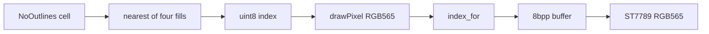

# 8bpp lantern palette

The figure stays the four flat regions from the No Outlines sheets. What changes is the storage and the glass palette: one index per pixel, into a fixed 256-color table, instead of four 1bpp layers tinted with PixelRoot32's 16 named colors.

PixelRoot32 stops at 4bpp, and that path is a `Color` index into a 16-entry table ([`Color.h`](third_party/pixelroot32/include/graphics/Color.h), `PALETTE_SIZE`). There is no 8bpp sprite. The engine fast path, when `logicalFrameBuffer8` is set, writes `packRgb565ToTftSprite8` (a 3-3-2 pack), which is not a palette index. `getSpriteBuffer` stays unset. 2bpp and 4bpp stay off. The engine tree is not patched.

## Palette

Sixteen ramps of sixteen steps. Index `row * 16 + step`. Built in linear light, then snapped to RGB565 so two neighbors cannot collapse to the same glass color. Green is the channel we nudge when a snap collides, because it has 6 bits. Every entry is a unique RGB565. Index 0 is `(0,0,0)`.

This panel is a 1.54" ST7789 in RGB565. Steps of one green quantum are invisible at arm's length, and the dark end crushes, so each ramp eases through linear light and the first steps jump. Hues stay far apart so a 12 px figure does not turn to mud.

Ramps, dark to light:

- 0 ink, black to warm paper
- 1 ash, blue-gray
- 2 dusk, indigo
- 3 tide, teal
- 4 glass, toward the sheet cyan
- 5 leaf, toward the sheet green
- 6 moss, the floor greens
- 7 lantern, gold
- 8 ember, toward the sheet orange
- 9 kiln, toward the sheet red
- 10 hazard, magenta, away from kiln
- 11 wine
- 12 clay
- 13 sand
- 14 iris
- 15 fog, cool gray to white

Pins overwrite the nearest step of that ramp, then any displaced color is nudged until the table is unique again. Exact values:

- 0: black, platforms, and sprite skip
- ink's last step: white `0xFFFF` (outlines and debug text)
- moss: PC `Color::DarkGreen` `0x13C2`, and linked ground `(0, 140, 32)`
- lantern: scan ground `(220, 180, 0)`
- kiln: link-down ground `(180, 0, 0)`, and the sheet red `(245, 85, 93)`
- hazard's hot end: spike `0xF81F`
- glass / leaf / ember: sheet cyan `(0, 205, 249)`, green `(153, 230, 95)`, orange `(255, 162, 20)`

Those four sheet colors are not the engine's `LightGreen`, `Cyan`, `Orange`, and `Red`. The figure moves to the colors in the PNG. The rest of the ramps are unused by this sprite and stay in the table for later art.

[`tools/gen_palette.py`](tools/gen_palette.py) (stdlib only) writes [`game/palette.c`](game/palette.c), [`game/palette.h`](game/palette.h), and a 16×16 swatch at [`refs/palette_lantern.png`](refs/palette_lantern.png) (16 px cells, so the steps are easy to see). Header exports `palette_rgb565[256]` and the four body indices. Both CMake target lists gain `game/palette.c`.

## Sheets

[`tools/pack_body_sheet.py`](tools/pack_body_sheet.py) keeps the same eight clips and the same nearest-of-four mapping. Alpha under 128, and only those four fills, become indices. Anything else in a cell still folds to the nearest fill, so a stray edge pixel does not invent a fifth color. Output is one `uint8_t` per pixel, row-major, 16×16, index 0 transparent.

[`game/body_sheet.h`](game/body_sheet.h) drops `BODY_LAYER_COUNT` and `body_sheet_rows`. [`body_sheet_frame`](game/body_sheet.c) returns the 256 bytes, or null outside the clip. 31 frames stay 31. Flash goes from 3968 bytes to 7936, plus 512 for the palette.

## Blit and drawer

[`draw_body`](host/engine_host.cpp) walks that frame. It skips 0, mirrors x when face is −1, adds `getXOffset` / `getYOffset` unless offset bypass is on, and calls `getDrawSurface().drawPixel` with `palette_rgb565[index]`. That is the raw RGB565 path already used by `drawFilledRectangleW`, so the PC SDL window and the panel get the same color. `drawSprite` is no longer used for the body.

[`st7789_drawer`](host/st7789_drawer.cpp) stops growing a 16-slot palette. `index_for` scans the 256 flash entries and returns 0 when the RGB565 is absent. `clearBuffer` no longer rebuilds the table. Present still does `palette_rgb565[src[x]]`. A pixel left untouched keeps its color, because the index no longer changes meaning between frames. The full-view ground is still the wipe. Every color this scene draws is one of the pins above, so nothing falls off the table.

## Docs

Update [architecture.md](architecture.md) in the same change. Look: the available palette is this 256-entry table; the current screen still uses a small subset (ground, black, white, magenta, four body slots). Sprites are 8bpp indices. Index 0 is skip. The 1bpp layers and the 4-color / 8-color cap are retired. 2bpp and 4bpp stay off. Display: `clearBuffer` no longer resets a growing palette. Memory: body sheet 7936, palette 512, both flash. Decision log line for 2026-10-16.

[README.md](README.md) only needs the figure clause: the body is those four pinned colors, not four 1bpp layers. Pose rules stay as they are.
