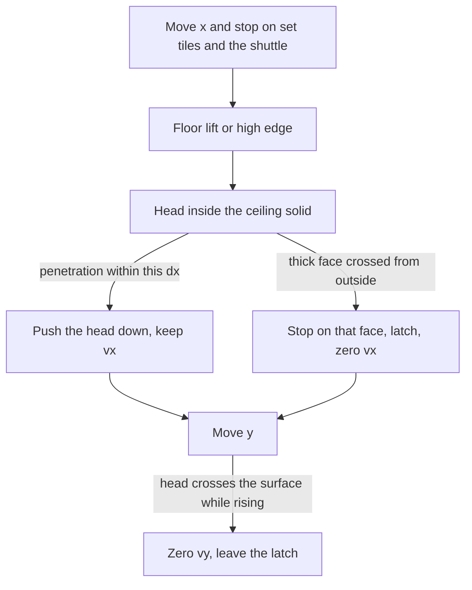

# Ceiling grades on the existing box

The body stays the 8×12 kinematic AABB. Floor slopes, the one-way lip, the shuttle, and the disk keep their tests in [game/world.c](game/world.c). A ceiling grade is not a floor and does not change the walk cap. There is no slide and no added speed, the same rule the floor grades already use.

`slope_is` is the range `MAP_SLOPE_R45` through `MAP_SLOPE_L3_2` (6–17). Ceiling kinds start at 18 so that range, `slope_support`, `slope_lift`, `slope_grade`, and the flat underside in `slope_ceil` ignore them. The underside of a floor slope stays the bottom edge of its tile.

## Grades

Twelve kind bytes, same segments and divisors as the floor. Rise is still `(segment * tile + along) / den` in subpixels. The ceiling line is `top + rise`, and the solid is above that line. The thin end is the top edge of the tile. The thick end, where the surface meets the bottom edge, exists only on the last segment of a run (`seg + 1 == den`), the same gate as `slope_face`.

R grows the rise with `+local_x`, so the thick end is on the right. L puts it on the left. That is the vertical flip of a floor grade: the floor wave’s peak becomes a bulge hanging down when the same kind order is used.

## How a tick meets a ceiling

- After the floor lift or wall, sample the ceiling surface over the head’s x span. The support is the lower surface (larger y) above the two top corners, so the box stays out of the solid.
- If the head is above that surface by at most this tick’s `|dx|` plus one pixel, push the body down until the head sits on it and keep vx. One pixel covers the `/3` truncation. A 45° at run speed drops about 2 px per tick, inside that limit. A drop deeper than the step does not press.
- Only the thick face, and only when this move crosses it from outside while the head is still above the surface. The thin end is not a wall. `move_down` still refuses the latch.
- The y sweep, while rising, treats the surface at the x already chosen as a ceiling. Crossing it from below zeros vy and leaves the latch. Falling does not catch on it. It is not a floor, so the jump and the ground line ignore it.
- A body that starts the y solve inside the solid is pushed down to the surface, and only down. The shallowest overlap still wins against set tiles, the shuttle, and a floor slope.
- No snap onto the ceiling. Gravity pulls the body off. The latch probe in `body_on_latch` treats the thick face like a floor high edge.

The 3×3 apron stays. At contact the head is in row 9 and the center tile is row 9 or 10, so that row and a lid on row 8 are inside the apron.

## Course and picture

Columns 33–44 are the flat after the shuttle gap and before the floor wave at column 45. Row 9 there gets the same sequence as row 13, columns 45–56: 45° both ways, the two-tile grade both ways, the gentle grade both ways, stored as ceiling kinds. Row 8, those same columns, is set, so each thin tip meets a lid.

A full jump is about 64 px. From the floor the head reaches about y 148, inside row 9 (y 144–160). Standing, the head stays near y 212, under the tile. The tall climb, the disk, and the exit stay where they are.

The snapshot already stores a kind byte per solid. It does not grow, and the internal spare stays. [world_slope_row](game/world.c) keeps filling a floor from the bottom. A ceiling row function fills the solid from the top, one black span per pixel row. [draw_slope](host/engine_host.cpp) draws either. The published rect stays the full 16 px tile, so the row mask restores the empty triangle to ground. Half tiles and corners stay unused.

## Record

In [architecture.md](architecture.md), replace the sentence that ceiling grades stay later. Name the twelve kinds, the press, the thick face, the flat floor underside that remains, and the row 9 wave under the row 8 lid. Half tiles and corners stay later. One decision-log row. The memory table does not change.

New helpers get the one-line Portuguese comment. Refresh the comments on `[body_solve_x]`, `[body_solve_y]`, `[body_stop_y]`, `[body_embed]`, `[body_on_latch]`, `[solid_box]`, `[set_crosses]`, `[world_solid_count]`, and `[world_solid_rect]`.
