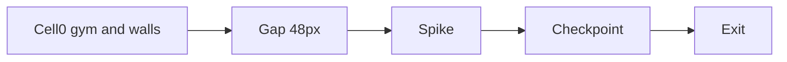

# Death and the first course

The LCG gym in [`game/world.c`](game/world.c) goes away. Solids become constants. Three non-solid marks and a pit turn that room into a course. One-way platforms, wedges, moving platforms, and a death sheet stay out.

## Course

All tops use the current floor line, `y = 224`, height 32. The 17-cell slab becomes two floors. A 48 px gap between them is the pit. Run speed is 700 subpixels per tick and a held jump travels about 70 px in the air, so the gap is a running jump.

Solids, cell plus local pixels, written once by the loader that replaces `solid_roll`:

- Floor under the gym: cell `(0, 0)`, `(0, 224, 240, 32)`.
- Left wall: `(80, 16, 16, 184)`. Right wall: `(144, 16, 16, 184)`. Faces at x 96 and 144, 48 px apart, bottom at y 200. Same job as the cage.
- Left stack, tops 40 px apart: `(8, 184, 64, 16)`, `(8, 144, 56, 16)`, `(12, 104, 48, 16)`.
- Right stack: `(168, 184, 64, 16)`, `(168, 144, 56, 16)`, `(176, 104, 48, 16)`.
- Floor after the gap: cell `(1, 0)`, `(48, 224, 240, 32)`. World x 288 through 528.

Marks are constants, not solids. [`range_overlaps`](game/world.c) is the test: touching an edge is not a hit.

- Spike: cell `(1, 0)`, `(112, 216, 48, 8)`. World x 352–400, the bottom 8 px of the body on that floor. Landing from the gap has about 64 px of floor before it.
- Checkpoint volume: cell `(1, 0)`, `(176, 176, 16, 48)`. World x 416. Its stand point is the body centered in that volume with feet on the floor: cell `(1, 0)`, local x 180, y 212. Overlap stores that point, not the live position.
- Exit volume: cell `(2, 0)`, `(16, 192, 16, 32)`. World x 496–512, on the second floor.

Spawn stays the center of cell `(0, 0)`, and that is the checkpoint until the volume is touched. Past either floor, or off the left of cell 0, the feet drop below y 256 and that is the pit.

## Tick

[`world_tick`](game/world.c) keeps the same integrate order while playing. After `body_solve_y`:

- Feet below y 256, or the body overlaps the spike: life becomes dying, hold becomes 16, and the tick stops. No jump, no camera step, no pose change. The body stays on the frame it died in.
- While dying, the tick only counts down. Input is ignored and the camera stays. At 0, place the body on the stored checkpoint the way [`body_place`](game/world.c) places the spawn: velocity, latch, pose, and contacts cleared, camera snapped, spring stopped.
- Overlap of the checkpoint stores the authored stand point. It sticks until restart.
- Overlap of the exit zeros velocity and sets life to finished. Later ticks return immediately. R and one BOOT still call `world_reset`, which reloads the same solids, clears the checkpoint back to spawn, and clears life.

Death does not rebuild the room. `roll_state` and the roll helpers (`roll_next`, `roll_pick`, `roll_width`, `solid_over`, `roll_span`, `solid_wall`, `solid_stack`, `solid_roll`) go away.

Life, hold, and the four checkpoint ints sit after the camera ints in the existing world slice. The 4096-byte slice and the level slice stay the sizes they are. `SOLID_CAP` stays 256. Ten solids are used.

## Draw

[`rect_scene::draw`](host/engine_host.cpp) already clips solids with `clip_view`. After the black solids, fill the spike with `drawFilledRectangleW` in magenta RGB565 `(31, 0, 31)`. That is the danger accent. It is not `Color::Red`, which is already a body layer. Checkpoint and exit are `drawRectangle` in `Color::White`, which is already on screen for the debug wire. With debug on, the screen is ground, black, the four body slots, white, and magenta: 8, the cap.

New readers next to `world_solid_rect`: one rect each for the spike, the checkpoint, and the exit. The host does not learn the life state.

## Docs

Update the comments whose `[id]` sentence stops being true, including `[world_init]`, `[world_reset]`, and `[world_tick]`.

[`architecture.md`](architecture.md): the room is this course, not an LCG; hazards are overlap after the solid response; dying holds 16 ticks; the exit freezes until reset; the world-slice note lists life, hold, and the checkpoint instead of the LCG; one decision-log line. [`README.md`](README.md) describes the same course for the PC window and the panel. One line on the decision log in [`open_questions.md`](open_questions.md).
