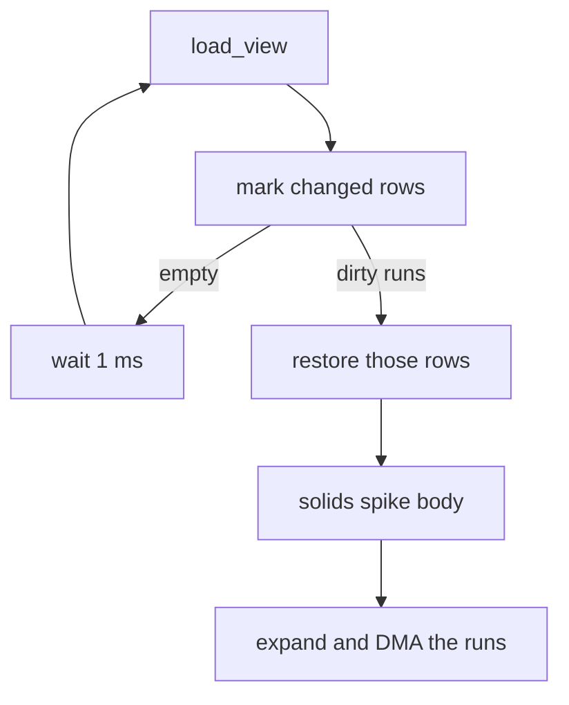

# Dirty rows and a coarse frame log

A full 240×240 ship cannot beat the glass. [host/st7789_drawer.cpp](host/st7789_drawer.cpp) `sendBuffer` always expands and sends two 120-row windows, about 12.3 ms, even when the picture is the same. The indexed buffer already keeps the last frame (`clearBuffer` is empty). This change stops rewriting and shipping the rows that stayed put, and adds a wall-clock log of the present frame while a PC is on the USB cable.

## Present

The 120-row DMA bands stay. They are the bounce, not the window. A 240-bit mask (30 bytes, static in the drawer) decides the window. `draw_bitmap` starts at the first dirty row of a run and stops at the end, capped at 120 rows so it still fits one band. The idle band still fills while the other is on the wire.

The mask is geometric, from the view [host/engine_host.cpp](host/engine_host.cpp) already publishes. No second indexed frame. Solids stay world-fixed, so the last camera, ground color, body pose and rect, spike, checkpoint, exit, and debug flag are enough. Those scalars stay static in the host.

- No previous frame, the ground color changed, or [st7789_resume](host/st7789_drawer.cpp) just re-inited the panel: all 240 rows. GRAM does not survive that resume.
- Camera moved: the old and new screen Y spans of every solid, the spike, the outlines, and the body. A flat ground row that none of those cross stays clean.
- Camera still, body or a hazard moved: only those old and new Y spans.
- Debug on and the camera moved, or debug toggled: all 240 rows. The cell wireframe has vertical lines. Debug text alone, with the camera still, dirties the top glyph rows.

A dirty run is restored before it is drawn: memset those rows to the ground index, then solids, spike, outlines, and the body in the same order as today, clipped to the run. Clean rows are not touched, so GRAM can keep them. An empty mask does not draw and does not call SPI.

An empty mask must not tight-loop Core 1. The present task waits 1 ms, the same pause the sim already uses, and tries again. A dirty frame does not take that wait.

The PC build keeps the full redraw. SDL has no row mask.

## Frame log

Compiler instrumentation and the engine's `PIXELROOT32_ENABLE_PROFILING` stay off. Both add work on functions that are not the cost. The clock is `esp_timer_get_time()`, wall microseconds, so a DMA wait is included. The CPU cycle counter is the wrong clock: the present task blocks in the SPI semaphore, and that wait is the long pole.

Four sections, non-overlapping, plus the gap:

- `draw` — restore and scene paint
- `expand` — palette into the bounce
- `spi` — wait for DMA and the bitmap submit
- `rest` — frame total minus those three

One line for `sim`, the last `sim_advance` on Core 0. It is not a percent of the present frame. The header carries frames in that second, how many were empty, and the mean dirty-row count, so the mask is visible without its own timer.

Each section prints mean µs, max µs, and percent of the mean frame, integer arithmetic. The print is outside those sections. Its own µs go on a `log` line so a one-second report is not blamed on `draw`.

The gate is the SOF frame index in `USB_SERIAL_JTAG.fram_num`, sampled once a second. If it moved, a host is on the cable and the next second is measured. `usb_serial_jtag_is_connected()` is not used: that call arms a check on every FreeRTOS tick. A power bank sends no SOF, so the timers stay off. Closing `monitor.bat` while the cable stays in the PC keeps the log on; the port-open state is not visible on this chip. While the gate is off, the section calls are one flag check.

If `draw` later dominates, split it. Until then it stays one line.

## Record

Update the display paragraph and the decision log in [architecture.md](architecture.md). The 30-byte mask and the last-view scalars are static, not new arena residents. The band and indexed-buffer rows stay as they are.
