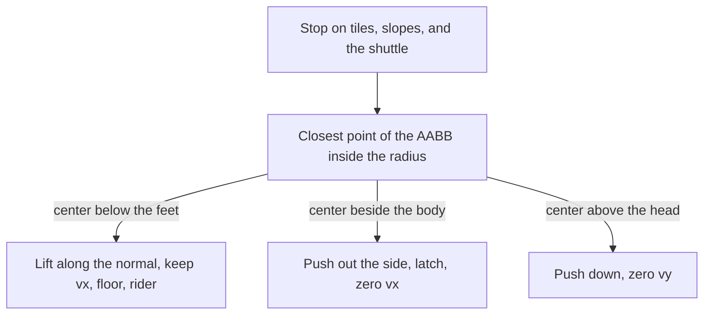

# Disk you can stand on

The body stays the 8×12 AABB. Set tiles, one-ways, slopes, and the shuttle keep the axis-separated face tests in [game/world.c](game/world.c). A circle is a separate solid, solved after those faces, because a radial push is the one correct way out of a circle. That push is not the diagonal AABB shove [architecture.md](architecture.md) rejects.

One disk. No second circle, no lethal bar, no orbit.

## Shape

Radius 32 px. The center sits 16 px below the floor line, on column 96 (world x 1544, y 240). A 16 px cap sticks out of the floor, about 55 px wide. The floor tiles stay, so the walk up to it is the existing floor. The buried half is black on black.

The exit moves from column 89 to column 104, so the cap is on the flat after the descent and there is still a runway. [game/map.c](game/map.c) only changes that tile and the file comment.

## How a tick meets the disk

- Overlap is the closest point of the AABB to the center. Reject with distance squared. One integer square root gives the penetration. Push the body along that point until it sits on the radius. No float.
- The center of this disk is under the floor, so a body on the cap or walking into the bump has the center below its feet: that contact is a floor. vy zeros, the latch clears, vx stays, [cam_note_ground] takes the feet, and the jump can use it. `move_down` does not drop through it.
- A circle whose center is between the head and the feet is a wall: vx zeros and the latch matches the side. `move_down` still refuses the latch. A center above the head is a ceiling.
- The step stays under the radius, so this static test does not tunnel. A swept circle stays out.
- The box rests on one point. The other foot floats, the same way it already floats on a 45° slope.

## Spin and carry

Phase is 256 steps per turn, plus one step every tick, including dying and finished. [world_reset] snaps it to 0. A checkpoint respawn leaves it, same as the shuttle.

Clockwise. Rim speed is that step's arc, about 65 px/s. While the previous tick's floor was this disk, the next tick adds the horizontal tangent before the solves: full speed to the left at the top, less toward the shoulders, none of the vertical component. A jump clears that rider. The body does not change the spin.

The phase is one int in the world tail. `WORLD_TAIL` goes from 14 to 15. The 4096-byte world slice stays.

## Picture

Present already rasterizes a slope from the snapshot kind through [world_slope_row](game/world.c). The disk follows that: the snapshot gains the phase, and a pure function of that phase fills the cap as black horizontal spans plus one white spoke from the center to the rim, only above the floor. The sim SoA is not read from present.

The spoke stays inside the cap, so a still camera marks those 16 rows when the spoke moves. A camera move marks the cap at the old and new screen Y. [ARENA_SNAPSHOT_BYTES](game/arena.h) grows by the phase int on both draw views. The static assert in [host/engine_host.cpp](host/engine_host.cpp) is the size check. Spare in the internal arena drops by that same amount.

## Record

Update [architecture.md](architecture.md): the circle solid, the cap, the tangent carry, the exit at column 104, the snapshot and spare rows, and one decision-log row. New helpers get the one-line Portuguese comment. Refresh the comments on [world_tick], [world_init], [world_reset], [body_solve_y], and [body_jump].
