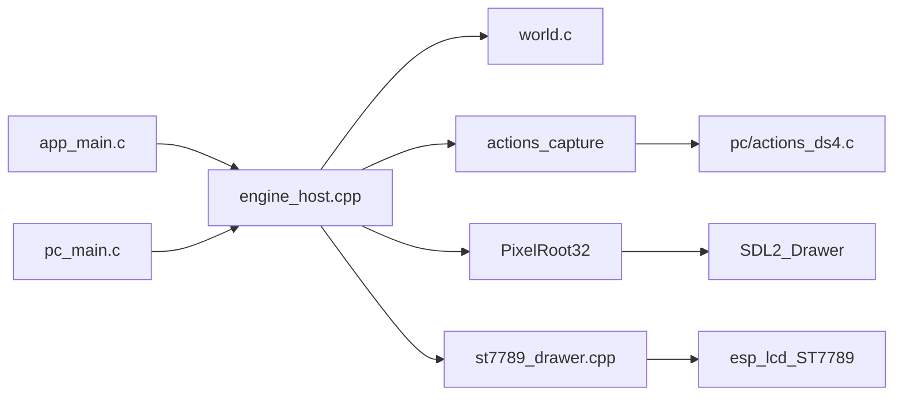

# ESPecter boilerplate and architecture rules

## Decisions this pass locks

- Game code is C++, compiled as C: plain structs, free functions, fixed-capacity SoA (parallel arrays), no classes, templates, exceptions, RTTI, or STL containers. Names are standard-library style: `snake_case` types, functions, and files (`world`, `world_init`).
- C++exists only where PixelRoot32 forces it. The engine stays an unmodified C++17 library. One host translation unit subclasses `Scene`. The device drawer subclasses `BaseDrawSurface`.
- PixelRoot32 **1.12.0** is a git submodule at [third_party/pixelroot32](third_party/pixelroot32), from `https://github.com/PixelRoot32-Game-Engine/PixelRoot32-Game-Engine`. The local zip at `d:\Repos\refs\PixelRoot32-Game-Engine-main` is not a git checkout, so it is the audit source, not the pin. No commit unless you ask.
- First program: one scene, one rectangle, same logical coordinates on PC and on the board. No jump physics, touch, IMU, or audio. The rectangle is two flat colors (background and figure), no gradient. On the device the BLE controller and host are started before the scene runs, and the rectangle stays still because HID is not parsed yet. On the PC the same rectangle moves from the DS4Windows pad.
- Logical resolution equals the panel: **240×240**, no upscale. That is what fits more of a level on the square glass. A full present is still about 12.3 ms of SPI, same as a scaled frame, because the wire always carries 240×240 RGB565. The cost of native pixels is RAM and draw time: an 8bpp logical buffer is **57600 bytes**, and it stays in internal RAM. Dirty rectangles are the later way to shorten a frame, not a second scaler. The static tilemap framebuffer cache stays off (it would duplicate those 57600 bytes).
- Device display is not TFT_eSPI. `DisplayConfig` already accepts `DisplayType::CUSTOM` and a caller-owned `DrawSurface` ([DisplayConfig.h](d:\Repos\refs\PixelRoot32-Game-Engine-main\include\graphics\DisplayConfig.h)). The drawer uses the same ESP-IDF path as the board hello: SPI3, mode 3, 80 MHz, ST7789, color invert, pins from [board.h](d:\Repos\jpgma\esp32-s3\boards\waveshare-touch-lcd-154\firmware\board\include\board.h).
- ESP-IDF **5.5 or newer**, target `esp32s3`, 16 MB quad flash at 80 MHz, octal PSRAM at 80 MHz, CPU 240 MHz (`CONFIG_ESP_DEFAULT_CPU_FREQ_MHZ_240`). Wi-Fi stays off. Bluetooth LE stays on. This machine does not have IDF at `%USERPROFILE%\esp\esp-idf`; scripts use `IDF_PATH` and stop with a clear message if it is missing.

## Why the engine cannot be dropped in

Upstream has no ESP-IDF component. Non-native builds include `Arduino.h`, and [DisplayConfig.h](d:\Repos\refs\PixelRoot32-Game-Engine-main\include\graphics\DisplayConfig.h) includes `SPI.h`. The checked-in ESP32 drawer is TFT_eSPI, whose examples use different pins and assume a 40 MHz SPI ceiling. This panel’s measured full RGB565 frame is **12271 µs** at 80 MHz, and there is **no TE pin**, so the glass cannot be vsynced.

The compatibility layer stays outside the submodule:

- [compat/Arduino.h](compat/Arduino.h) and [compat/SPI.h](compat/SPI.h): only the symbols the enabled subset actually needs (`millis`, `micros`, `delay`, `yield`, GPIO, `Serial` as `printf`, `pgm_read_*`). `yield` maps to a FreeRTOS yield. Do not define `ARDUINO_ARCH_ESP32`.
- Compile flags: `-std=gnu++17 -fno-exceptions -fno-rtti`, `PIXELROOT32_NO_TFT_ESPI`, `PIXELROOT32_NO_I2S_AUDIO`, and `PIXELROOT32_ENABLE_AUDIO/PHYSICS/PARTICLES/UI_SYSTEM/TOUCH/SCENE_TRANSITIONS/CAMERA_EFFECTS=0`.
- Exclude `src/drivers/esp32` from the device build and `src/drivers/native` from the device build. The PC build defines `PLATFORM_NATIVE` and compiles the SDL2 drawer instead.

If the first link fails on another Arduino symbol, add that symbol to the shim. Do not vendor a second copy of the engine to patch it.

## Folder layout

Flat on purpose. The tree in [initial_idea.md](initial_idea.md) is not created yet.

```text
ESPecter/
  CMakeLists.txt
  sdkconfig.defaults
  architecture.md
  README.md
  .gitignore
  .cursor/rules/architecture.mdc
  .cursor/rules/c-style.mdc
  main/app_main.c
  game/arena.h
  game/arena.c
  game/actions.h
  game/actions.c
  game/world.h
  game/world.c
  host/engine_host.h
  host/engine_host.cpp
  host/st7789_drawer.h
  host/st7789_drawer.cpp
  compat/Arduino.h
  compat/SPI.h
  pc/CMakeLists.txt
  pc/main.c
  pc/actions_ds4.c
  scripts/flash.bat
  scripts/monitor.bat
  scripts/pc.bat
  third_party/pixelroot32/   # submodule
```

`game/` never includes PixelRoot32 or ESP-IDF. `arena` is a bump pointer over one block taken at boot and never returned. `world` keeps its SoA fields inside a slice of that block. `engine_host.cpp` owns the `Scene`, calls `world_*`, and is the only file that talks to `Engine`. `app_main` drives `BAT_EN` (GPIO2) high, starts BLE, creates the arena, then calls `engine_host_run()`. The drawer turns the backlight on after the panel is up. GPIO45 and GPIO46 are strapping pins; they are configured only after boot, as outputs, by the panel and backlight code.

PC [pc/main.c](pc/main.c) calls the same `engine_host_run()`. [pc/CMakeLists.txt](pc/CMakeLists.txt) is a normal CMake project, not ESP-IDF. It fetches SDL2 if it is not already installed (MSYS2 is not present here). The engine includes `<SDL2/SDL.h>`, so the include path has to be the parent of an `SDL2` directory. The PC target compiles [pc/actions_ds4.c](pc/actions_ds4.c) instead of [game/actions.c](game/actions.c). The device target never sees that file.




## Hardware constraints written into architecture.md

Source of truth for measurements stays [HARDWARE.md](d:\Repos\jpgma\esp32-s3\boards\waveshare-touch-lcd-154\HARDWARE.md). [architecture.md](architecture.md) states the consequences, not a second pin encyclopedia:

- Panel is write-only ST7789, 240×240 visible, GRAM 240×240, RGB565, SPI mode 3 at 80 MHz. One full frame is about 12.3 ms on the wire. No MISO, no TE, so tearing is a hardware fact. The drawer presents 1:1, in DMA bands, and does not keep a second full RGB565 frame. Dirty rectangles are the later mitigation.
- A full RGB565 frame is 115200 bytes. DMA-visible scanout lives in internal RAM, next to the BLE controller. PSRAM (8 MB octal) is for cold data. Wi-Fi stays off: its DMA cannot live in PSRAM, and this game does not need it. BLE cannot be moved to PSRAM either, so the framebuffer and the controller share internal RAM from the first boot.
- Flash is 16 MB quad, not OPI. `sdkconfig.defaults` must set that or the image will not match the chip.
- `BAT_EN` high before any blocking call, including later deep sleep. USB Serial/JTAG dies in deep sleep. No I2C fuel gauge.
- One I2C bus (GPIO41/42) for QMI8658A `0x6B`, CST816D `0x15`, ES8311, and ES7210. No second bus, so those devices stay uninitialized until one owner exists. Touch is one finger. IMU has no magnetometer, so yaw is not observable.
- Buttons: PLUS GPIO4 and BOOT GPIO0 are the later on-device fallback. PWR GPIO5 is the power latch, not a game button.
- Speaker and ES8311 exist. PixelRoot32’s I2S backend is a bare DAC, not this codec. Audio stays out of this binary. The later path is in the Nidhogg section: PCM through ES8311, not the engine’s NES voices.
- The Q36XDV is the gamepad, and it is not on the board. The chip is BLE only, so Classic HID is not an option. `sdkconfig.defaults` enables the BLE controller (Bluedroid, BLE-only), which is what the IDF 5.5 `esp_hid_host` example uses on `esp32s3`. `app_main` raises `BAT_EN`, starts that controller and the host, logs the free heap, then starts the scene. It does not connect to the first HID it sees. The pad’s switch **X** name is `Xbox Wireless Controller`. The report map is still unread, so the device does not map buttons yet. The radio does.

## Look and sound: Nidhogg (2014), not Nidhogg 2

Reference is Messhof’s first game only. Mark Essen kept the art to flat colors at low resolution so animations stayed consistent and cheap to change. The pixels are chunky and featureless, the figures are silhouettes, and each arena is a different small palette. Nidhogg 2 (higher detail, 640×360, bone animation) is not the target. Do not copy that game’s sprites, palettes, or Daedelus’s tracks.

What goes into [architecture.md](architecture.md):

- Per screen: a handful of flat colors. Start at 4, hard cap 8. No gradients, no dithering, no separate outline pass.
- Sprites are 1bpp or 2bpp silhouettes with a few frames. The engine’s indexed palettes match this. RGB565 is only the wire format inside the drawer.
- Danger is one accent color, and those pixels are the hazard volume. Decorative pixels do not kill.
- The body stays an AABB. Nidhogg’s pixel-precise sword hits are not the collision model. Movement feel is N++, in the next section.
- The sketch’s wheel, spikes, and walkways become bold shapes. A tooth is a few pixels, not a drawn mechanism.
- The glass is square and the view is the full 240×240, chosen so a level can be larger. Nidhogg’s frame is wide, so a centered camera here still hides the next trap. When a camera exists, it leads in the facing direction.
- The ninja is about **16 pixels** tall. On this 1.54" panel that is roughly 1.8 mm, which is the tradeoff for seeing more course. Hazards stay high-contrast silhouettes so they read at that size. The boilerplate rectangle is about 16×16, in the same two flat colors.
- Animation budget later: idle, run, jump, death. No skeletal animation.

Audio path:

- Daedelus’s score is sample-based IDM (breaks, plucks, warped snippets), and the game’s effects are sparse. PixelRoot32’s pulse/triangle/noise voices cannot carry that, so `PIXELROOT32_ENABLE_AUDIO` stays **0** for good, not only for this binary.
- Later music and effects are short PCM clips in flash, played through the ES8311. The speaker and codec are already on the board. Gate the PA (GPIO7) only while sound is coming out. One owner for I2S, same rule as the shared I2C bus.
- Stream from flash. A 16 kHz mono 16-bit clip is 32 KB per second, so a two-minute loop is about 3.8 MB of the 16 MB flash and only a small internal buffer in RAM. No MP3 decoder, and no decoded song kept in RAM.
- Silence is a valid mix. Do not add a sound for every action.
- None of this is built now. The boilerplate still does not init I2C, I2S, or the codec.

## PC gamepad stand-in

The device keeps its own BLE stack and does not parse HID yet. The PC build simulates that pad so input can be tried without flashing. DS4Windows already owns the Bluetooth radio and, in its default profile, exposes an Xbox 360 controller through ViGEm. The PC process does not open a second radio and does not link Bluedroid.

[pc/actions_ds4.c](pc/actions_ds4.c) is compiled only by the PC CMake target. It calls `SDL_InitSubSystem(SDL_INIT_GAMECONTROLLER)` and reads the first controller SDL sees. SDL on Windows reads that XInput device, so a DS4, DualSense, or similar pad that DS4Windows has connected shows up without any device source changing. If DS4Windows is set to a virtual DualShock instead of the Xbox 360 pad, this reader will not see it. The default Xbox profile is the one the sim supports.

[game/actions.h](game/actions.h) is the snapshot both builds share: held `move_left`, `move_right`, `jump`, `pause`, `confirm`, and `cancel`. The host calls `actions_capture` once per update and moves the rectangle from those fields. The device links [game/actions.c](game/actions.c), which writes a clear snapshot and includes no SDL, XInput, or DS4Windows. The rectangle on the board therefore stays still.

Sim map, for the Xbox layout DS4Windows emits, not a claim about Q36XDV report bytes:

- D-pad left or right, or the left stick past a dead zone: `move_left` / `move_right`. The rectangle steps horizontally.
- South button (A, Cross on the physical DS4): `jump`. The rectangle steps up while held.
- Start: `pause`. Back/B: `cancel`. South is also `confirm` while held, so the same button can be checked both ways until the real report map exists.
- No controller connected: snapshot stays clear, the window still opens, the rectangle stays centered.

## Physics: N++, not the engine solver

Nidhogg stays the look and the sound. N++ is the movement. This binary still does not run or jump. [architecture.md](architecture.md) records the rules so the first real controller does not start from PixelRoot32’s impulse solver or from a port of the school project.

References, both cited in the architecture file:

- Metanet, [N Tutorial A — Collision Detection and Response](https://www.metanetsoftware.com/2016/n-tutorial-a-collision-detection-and-response). This is the solver we follow: tile world, move then respond, separate horizontal and vertical, swept tests so a fast fall does not tunnel.
- [d:\Repos\refs\school-n--master](d:\Repos\refs\school-n--master), a high-school N++ demo. Read it for the mechanic list, not for structure. `Ninja::update` integrates speed, a held jump, extra gravity while falling, drag, and wall friction, then separates a convex hull by overlap. `SquareTile` and `WedgeTile` are the solid shapes. Wall contact can launch a jump off the wall normal.

What we take from that demo: variable jump, heavier fall, wall slide and wall jump, square tiles first, wedges later, hazards as overlap rather than as floors.

What we do not take: the class tree, `std::vector`, a `new` per overlap, `double` with a variable `deltaTime`, the stick-figure skeleton, or the constants `MOVE_SPEED` / `GRAVITY` / `JUMP_FORCE`. Those numbers belong to that sim’s clock. Our step is fixed, and the feel constants get tuned on that step. Do not copy the demo’s source or N++’s levels into this repo. The references stay outside it.

Locked with that:

- `PIXELROOT32_ENABLE_PHYSICS` stays 0. One collision truth, and it is game code.
- The ninja is kinematic. Position and velocity live in the SoA tables. Response is the tutorial’s, not an impulse solver and not SAT against every hull.
- First physics slice, when it exists, is solid square tiles plus the body AABB. Wedges, one-way platforms, and moving platforms come after that slice is repeatable.
- Mines and other killers overlap. They do not push the body.
- The same C step runs on PC and on the device, so a later host test can assert position without the panel. The SoA rows live in the arena slices below, not in a `malloc` per entity.

## Memory layout

[architecture.md](architecture.md) gets a memory section that is the layout, not a paragraph of advice. Three stores, then every resident, then the arena rules. A size changes only by editing that table in the same change.

Stores on this module:

- Internal SRAM is 512 KB. DMA and the BLE controller have to live here. PSRAM cannot hold them.
- PSRAM is 8 MB octal. The game arena is one block here. The other 8 MB stay free so a stray heap allocation is visible.
- Flash is 16 MB quad. Code, read-only sprites, and later PCM. The arena is not in flash.

Who may allocate:

- IDF and PixelRoot32 allocate their own residents from the heap. The engine has no arena hook, and we do not fork it to add one. Those blocks are listed below and are not inside the game arena.
- Game code allocates only through `arena`. `game/` does not call `malloc`, `free`, `new`, or `heap_caps_malloc`. There is no `arena_free`. The block is taken once at boot and never returned.

`arena` is a base, a capacity, and an offset. `arena_slice` bumps that offset, aligned to 8 bytes, and returns a pointer into the block. If the offset would pass the capacity, boot fails. Per-frame work overwrites the scratch slice in place. It does not bump. A rewind API would be a way to drop memory, so there isn't one.

The device block comes from `heap_caps_malloc` with `MALLOC_CAP_SPIRAM`, once, after BLE is up. The PC build uses one `malloc` of the same size, also never freed. Same carve order on both.

Starting layout, written into the architecture table:

- BLE controller and host. Internal RAM. IDF. Size is whatever the first boot log reports. Not guessed in the table before that log exists.
- FreeRTOS stacks, including the BT host task. Internal RAM. IDF.
- Present band. Internal RAM, DMA-capable. 16 rows of 240 RGB565 pixels, which is 7680 bytes. One band, reused every transfer. No second full frame. A full RGB565 frame would be 115200 bytes and is not reserved.
- Engine logical buffer. Internal RAM. 240×240 8bpp is 57600 bytes, allocated by PixelRoot32 when the scene starts. Hot pixels stay out of PSRAM.
- Game arena. PSRAM. 65536 bytes, never freed. Carved at init in this order:
  - `world`, 4096 bytes. SoA for a fixed entity cap. The boilerplate rectangle uses the first row.
  - `level`, 32768 bytes. Reserved for tile bytes and later mechanism records. Empty in this binary.
  - `scratch`, 16384 bytes. Overwritten every frame. The offset does not move.
  - Spare, 12288 bytes. Still owned by the arena. Growing a slice takes from here and updates the table.

Boot log, after the carve and after the engine buffer exists: free internal heap, largest free internal block, free PSRAM, arena capacity, arena offset. The measured BLE and engine lines in the architecture table get those numbers when a device log exists. Until then the cells say unmeasured.

## Rules

[.cursor/rules/architecture.mdc](.cursor/rules/architecture.mdc) is always on. It points at [architecture.md](architecture.md) and requires that file to be updated in the same change whenever a decision there changes, including a slice size or a new resident in the memory table.

[.cursor/rules/c-style.mdc](.cursor/rules/c-style.mdc) applies to `game/**`, `main/**`, `host/**`, and `compat/**`: snake_case, SoA, C in `game/` and `main/`, C++ only in the host and the drawer, with a short good/bad example.

## Docs to update

- [architecture.md](architecture.md): the decision record above, including a short decision log.
- [README.md](README.md): submodule init, `scripts\pc.bat`, `scripts\flash.bat`, `scripts\monitor.bat`, and the IDF 5.5 prerequisite.
- [open_questions.md](open_questions.md) decision log: R-01 (custom drawer plus shim, not a fork), R-02 (board facts from HARDWARE.md), display resolution, ESP-IDF 5.5 minimum, touch/IMU deferred. R-04 records that BLE is on from the first device boot (Bluedroid, BLE-only, Wi-Fi off), that the HID report map is still open, and that the PC stand-in reads the DS4Windows Xbox pad without touching device sources. R-05 records ownership: custom kinematic step from Metanet tutorial A, school demo as a mechanic reference only, engine physics left compiled out. Timestep length and feel constants stay open until something actually jumps. R-06 records the arena: one 64 KB PSRAM block, carved once, never freed, with the internal residents listed beside it. BLE's byte cost stays unmeasured until the boot log. R-10 records the Nidhogg 1 art rules (4-color screens, 1bpp/2bpp, no copied assets). R-12 records that the NES audio voices stay off and that later sound is PCM on the ES8311, still not built. Leave measured frame budgets open.
- One line at the top of [initial_idea.md](initial_idea.md) pointing at architecture.md as the decision record. The proposal itself stays.

## Verification

- `scripts\pc.bat` configures, builds, and opens a window with one ~16×16 rectangle on a 240×240 view. With DS4Windows running in its default Xbox 360 profile, the left stick or d-pad slides the rectangle and the south button raises it. With no controller, the rectangle stays centered. Close the window to exit.
- Device build runs only if `IDF_PATH` is set. Flash is not assumed. If IDF is present, `scripts\flash.bat` builds for `esp32s3` and flashes; the panel shows the same rectangle, still, and the backlight is on.
- The device log shows the BLE controller up, then the arena capacity and offset, then free internal heap, the largest free internal block, and free PSRAM. No gamepad is required for the rectangle to appear. Neither target initializes I2C, Wi-Fi, the codec, or the IMU. The PC build does not open a Bluetooth radio. It still creates the same arena and never frees it.

