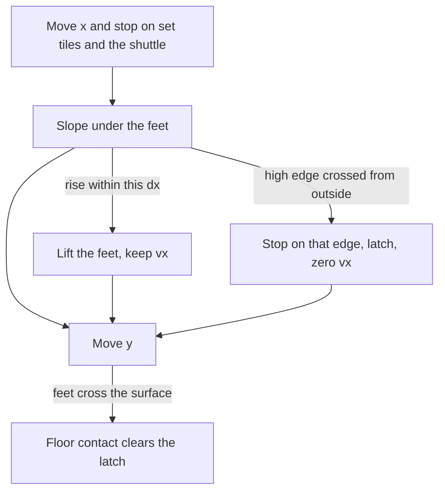

# Floor slopes on the existing box

The body stays the 8×12 kinematic AABB. A circle would hug the grade, and it would replace the collision truth in [game/world.c](game/world.c): the wall latch is a vertical face, a one-way is a top plane, the shuttle is a box, and an inside push takes the shorter axis. A circle against those corners produces the diagonal shove [architecture.md](architecture.md) already rejects. It also cannot be both 8 px wide and 12 px tall, so the cage tune would move. `PIXELROOT32_ENABLE_PHYSICS` stays 0.

The visible cost of the box: support is the higher surface under the two bottom corners, so the box never enters the solid. On a 45° ramp the downhill foot floats by up to 8 px (4 px on the two-tile grade, about 3 px on the gentle grade). If that float looks wrong once it is on screen, the later change is where the feet sample, not a new body shape.

## Grades from the sheet

[PlatformerTilesetTemplate_Tileset.png](refs/PlatformerTilesetTemplate_AssetPack/PlatformerTilesetTemplate_Tileset.png) is 13×10 tiles of 16 px. Floor solids are filled under the outline. Collision uses the ideal line, not the 1 px outline. Twelve kind bytes, still one byte per tile. The 3×3 apron stays nine bytes.

- 45°, one tile: tiles 77 (rises right) and 80 (rises left). Surface drops 1 px per px.
- Two-tile grade: 81 then 82 rise right (8 px, then 8 px). 85 then 86 rise left.
- Gentle grade: three tiles, not four. 87, 88, 89 rise right. 92, 93, 94 rise left. In subpixels the rise along the run is `(segment * tile + local_x) / 3`. The end of the third tile lands on the top edge, because `48 px * 256` divides by 3.

Low end of every ramp is the bottom edge of its tile. High end of a finished run is the top edge. Ceiling tiles (96 and onward) stay unused. Half tiles and corners stay unused.

## How a tick meets a ramp

Set tiles, the one-way lip, and the shuttle keep today’s x-then-y faces. A floor slope is not a box in those tests.

- After the x stop, sample both bottom corners. The support is the higher slope surface under them.
- If the feet are below that surface by at most this tick’s `|dx|` plus one pixel, lift them onto it and keep vx. One pixel covers the `/3` truncation. The steepest grade is 1:1, so a real ramp always fits. A 16 px cliff does not: run speed climbs about 2 px per tick, a wall jump about 4.
- The tall leg is that case. Only the high edge, and only when this move crossed it from the outside while the feet are below the surface. The low edge is not a wall. `move_down` still refuses the latch, as it does on a set tile.
- The y sweep treats the surface at the x already chosen as a floor face. Falling onto it zeros vy, sets floor contact, and clears the latch. Jump uses that floor. `move_down` does not drop through it.
- While the previous tick was a floor and the surface is at most the 6 px fall cap below the feet, snap down onto it. That follows the ramp. An empty pit is not a surface, so the snap does not cross the gap.
- A body that starts the tick inside the solid is pushed up to the surface. The push is upward only, so it does not become the sideways embed a full box would do.
- The underside of a floor slope is the bottom edge of the tile, a horizontal ceiling. There is no slide along the underside. Ceiling grades stay later.

## Course and picture

Cell 3 is the first plain floor after the shuttle. Row 14 stays set. Row 13, columns 45–56, is one wave: 45° up and down, the two-tile grade up and down, the gentle grade up and down. Each toe sits on the floor line. Column 58 is one more 45° rising right, with column 59 empty, so the right edge is a cliff and the left edge can still be walked up. The pit, spike, checkpoint, exit, shuttle, walls, and one-ways stay where they are.

Present still draws black. The tileset stays in `refs/`. [draw_view](host/engine_host.cpp) gains a kind byte per solid slot. A set tile and the one-way lip draw as they do now. A slope is filled with one horizontal rect per pixel row of the solid, clipped to the view. The row mask marks the full 16 px tile so the empty triangle is ground again. `WORLD_SOLID_CAP` stays 256. [ARENA_SNAPSHOT_BYTES](game/arena.h) follows the existing `static_assert`; the growth is the kind array on both copies, taken from the internal spare. The level slice does not grow.

## Decision record

In [architecture.md](architecture.md), replace “Wedges are still later.” Name the three floor grades, the ride, the cliff, the descend snap, and the cell 3 wave. Say the body stays an 8×12 AABB. One decision-log row. Update the snapshot and spare rows. Refresh the comments on `[body_stop_x]`, `[body_stop_y]`, `[body_solve_x]`, `[body_solve_y]`, `[body_embed]`, `[world_tick]`, `[world_solid_count]`, and `[world_solid_rect]`. New helpers get the same one-line Portuguese comment.