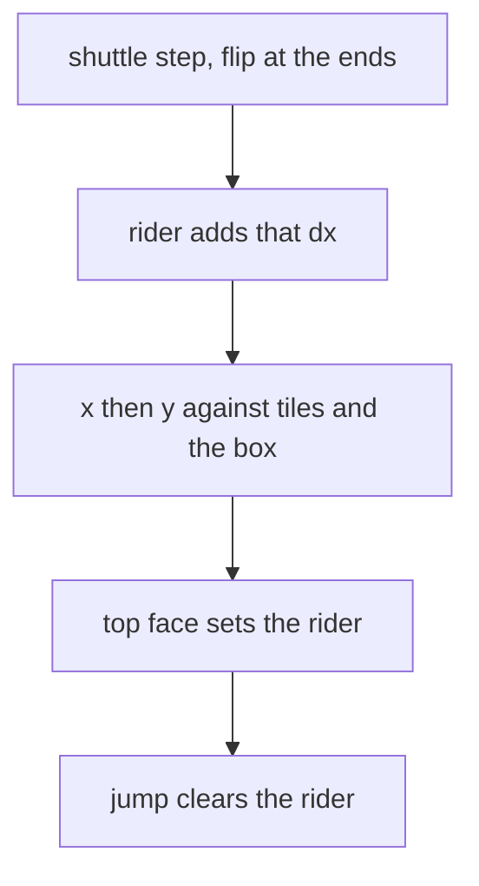

# Horizontal shuttle

The shuttle is a kinematic AABB in the world slice. PixelRoot32 physics stays compiled out. A `RigidActor` integrates force, mass, and a variable `dt`, and `KinematicActor::moveAndSlide` is the same kind of rewrite: the ninja, the one-way plane, and the wall latch would leave the 12 ms sweep. A path is a step function on that tick. Mass is not stored. The mind is the ping-pong.

Start here, and nowhere else. No wheel, no door, no second mover, no wedge, and no growth of the PSRAM arena. Engine physics stays off.

## Course

In [`game/map.c`](game/map.c), clear row 14, columns 30–32. That is the first 48 px of cell 2 (world x 480–528). The pit in cell 1 stays.

The shuttle is 32×16. Its top sits on the floor line, y 224, so the slab fills the gap the way a floor tile does. It ping-pongs from x 464 to x 496: the left end overlaps cell 1’s last floor tile, and the right end meets column 33. Speed is 32 px/s through `PIXPS_TO_SUBPIXPT`, one second each way.

## Mind

Two ints join the world tail in [`game/world.c`](game/world.c): subpixel x and direction (`+1` / `-1`). [`world_init`](game/world.c) and [`world_reset`](game/world.c) snap it to x 464, direction positive. A checkpoint respawn leaves the phase. The step runs at the start of every [`world_tick`](game/world.c), including dying and finished, so the phase is ticks since reset. At either end the direction flips and the position clamps. The body does not push it.

## Sweep and carry

The apron stays tiles. The shuttle is one extra box, tested beside the set tiles in [`body_stop_x`](game/world.c) and [`body_stop_y`](game/world.c), with the same strict face test. A side stops that axis and latches. The top is a floor: `vy` zeros, the latch clears, and [`cam_note_ground`](game/world.c) takes the feet. The underside is a ceiling. `move_down` does not drop through it.

A rider flag in the tail is set when the winning floor face is the shuttle top. On a tie with a set tile at the same height, the shuttle wins, so the overlap at either end keeps the carry until the body no longer covers the slab. [`body_jump`](game/world.c) clears the rider. The jump keeps the body’s own `vx`.

Order inside the playing tick, after gravity and before the solves: step the shuttle, then if the rider flag is set add that `dx` to the body, then the existing x and y solves see the box at its new x.

## Present

The solid list stays the flash strip. [`draw_view`](host/engine_host.cpp) gains one `shuttle` rect, published in pixels like the spike. The host fills it black next to the solid loop, clipped to the view. The row mask compares the previous rect on both camera paths, the same way it already compares the spike, so a still camera still redraws the rows the slab leaves. [`ARENA_SNAPSHOT_BYTES`](game/arena.h) follows the `static_assert`: 8396 becomes 8428. Those 32 bytes come from the internal spare, which goes from 9648 to 9616. The 4-byte alignment gap stays.

## Record

In [`architecture.md`](architecture.md), name the shuttle, the gap, the rider step, and the phase. The collision-truth sentence stays: engine physics remains off. One decision-log row. Update the snapshot and spare rows in the memory table. Refresh the comments for [`world_tick`](game/world.c), [`world_init`](game/world.c), [`world_reset`](game/world.c), [`body_stop_x`](game/world.c), [`body_stop_y`](game/world.c), [`body_solve_x`](game/world.c), [`body_solve_y`](game/world.c), and [`body_jump`](game/world.c).
