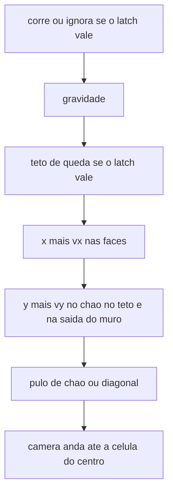

# Mundo em células de 240

A gaiola deixa de existir. Não há borda sólida na View. A posição de cada coisa é um índice de célula e uma posição dentro dela. A célula é `WORLD_VIEW` (240). O tick, o feel e o latch de parede nas faces de sólido continuam.

## Coordenada

Em [`game/world.c`](game/world.c) o corpo guarda `cell_x`, `cell_y` e o local em subpixels. O local canônico fica em `[0, 240<<8)`. Célula negativa usa divisão para baixo, não o truncamento do C em direção a zero. `WORLD_COLS` passa de 12 para 14. A slice `world` continua 4096.

O sweep não muda de espaço: no começo do eixo, compõe `cell * (240<<8) + local`; no fim, separa de novo. Um `int` aguenta cerca de ±17000 células antes do subpixel estourar. Este chão fica perto da origem.

A célula da câmera é a do centro do corpo (canto superior esquerdo mais 8 px), não a do canto. Cruzar a linha com o centro troca o alvo naquele tick.

Os sólidos na slice `level` passam a seis colunas `int`: `cell_x`, `cell_y`, local x, local y, `w`, `h`. O local do sólido é pixel, origem no canto superior esquerdo, também em `[0, 240)`. `w` e `h` podem atravessar células. [`solid_box`](game/world.c) compõe as arestas em subpixels na hora do teste.

`SOLID_CAP` 256. 256 × 6 × 4 = 6144 bytes dos 32768. A slice não cresce. Lista maior que o cap faz [`world_init`](game/world.c) falhar.

## Chão

Os quatro retângulos de prova saem. Fica um:

- Célula do canto: `(-8, 0)`, local `(0, 224)`, tamanho `4080×32` (17 × 240).
- Cobre as células x de −8 a 8, com o topo na linha em que a gaiola parava a queda.
- Sem tecla, o corpo nasce no centro da célula `(0, 0)`, cai e pousa nesse topo.
- Passar da ponta esquerda ou direita é queda sem chão e sem borda.

As bordas da View saem de [`body_stop_x`](game/world.c), [`body_stop_y`](game/world.c) e [`body_on_latch`](game/world.c). [`body_span`](game/world.c) sai. Latch, chão e teto ficam só nas faces do sólido.

Um pulo segurado sobe cerca de 64 px. Da beira do chão (pés em y 224) os pés chegam perto de y 160, então um topo acima disso não se alcança num pulo só. A célula de cima continua fora de alcance. O deslize vertical é o mesmo código; este graybox só mostra o horizontal quando se corre para fora da célula 0.

## Plataformas do reset

O sólido 0 é o chão e não muda. Os sólidos 1 a 4 são quatro retângulos na célula `(0, 0)`, todos visíveis com a View assentada. [`world_init`](game/world.c) sorteia o primeiro conjunto. [`world_reset`](game/world.h) sorteia de novo, devolve o corpo ao centro, zera velocidade, contatos e latch, e encosta a câmera na célula 0.

O sorteio é um LCG na slice `world`, semente 1 no boot. Cada reset avança essa semente. Não usa `rand` nem relógio, então a sequência repete a cada boot. Sem `malloc`.

As faixas cabem no pulo e deixam um corredor no meio. A coluna do spawn, x 96–144, fica vazia: o corpo nasce em x 112 e cai no chão sem começar dentro de um sólido. Altura de todos é 16. Nenhum par se sobrepõe, e a base de cada um fica em ou acima do topo do chão.

- Dois baixos, um de cada lado do corredor. Topo em y 176–200 (24 a 48 px acima do chão). Largura 40, 56 ou 72. O esquerdo termina em ou antes de x 96. O direito começa em ou depois de x 144 e termina em ou antes de x 232.
- Dois médios, cada um em cima de um baixo. O topo fica 32 a 56 px acima do topo desse baixo, dentro dos 64 px do pulo segurado. Largura 32 ou 48. O x cobre parte do baixo de baixo, sem entrar no corredor.

Assim dá para andar no chão entre eles, subir num baixo com K, e do baixo alcançar o médio. A face vertical de um deles ainda grava o latch.

## Câmera

Dois `int` na slice `world`, depois da SoA: origem da View em subpixels do mundo. No boot ela já mostra a célula `(0, 0)`.

No fim de [`world_tick`](game/world.c), o alvo é a origem da célula do centro (`cell * 240` em cada eixo). Cada eixo anda no máximo 4 px por tick (`1024` subpixels) e encosta no resto menor. Uma célula inteira leva 60 ticks, cerca de 1 s. A corrida é 3 px/tick, então a View alcança quem corre. Se o alvo mudar no meio do deslize, a câmera passa a mirar a célula nova.

A frase da seção Look em [`architecture.md`](architecture.md), de que a câmera antecipa a direção, deixa de valer. Aqui a View descansa no centro da célula ocupada.

[`world_camera`](game/world.h) escreve a origem em pixels do mundo. [`world_rect`](game/world.h) e [`world_solid_rect`](game/world.h) continuam em pixels do mundo, já compostos (`cell * 240 + local`).

O desenho usa o que o PixelRoot32 1.12.0 já faz, sem ligar flag novo e sem patch no `third_party`:

- [`Renderer::setDisplayOffset`](third_party/pixelroot32/include/graphics/Renderer.h) recebe `(-câmera_x, -câmera_y)` uma vez por present. O corpo e os sólidos são desenhados em coordenada de mundo; o `Renderer` soma o offset antes do drawer. O deslize continua no tick de 16 ms. O offset só amostra essa câmera.
- Cada sólido é cortado ao retângulo da câmera ainda em coordenada de mundo, então a largura e a altura que seguem têm no máximo 240. O chão de 4080 px não entra inteiro no laço. No device, [`st7789_drawer::drawFilledRectangle`](host/st7789_drawer.cpp) já recorta e, quando a faixa cobre a largura da View, preenche a linha com `memset`. No PC o `SDL2_Drawer` pinta pixel a pixel e recorta em `setPixel`; sem o corte prévio ele varreria os 4080.
- Fundo, FPS e bateria usam [`setOffsetBypass(true)`](third_party/pixelroot32/include/graphics/Renderer.h). O `drawText` desenha por `drawSprite`, e o sprite também recebe o offset. Sem o bypass, o texto andaria com a célula.
- O wireframe do debug é [`drawRectangle`](third_party/pixelroot32/include/graphics/Renderer.h), não quatro retângulos preenchidos. No device a base desenha o contorno por `drawPixel`, que já ignora o que cai fora. Só entram as células que cruzam a View, no máximo quatro.

Ficam de fora, porque brigam com decisão já tomada:

- Tilemap, cache estático e `LayerType`: tiles continuam para depois, o cache duplicaria os 57600 bytes e `PIXELROOT32_ENABLE_STATIC_TILEMAP_FB_CACHE` segue 0. Um AABB não vira mapa.
- Dirty regions e `setDebugDirtyCellOverlay`: a grade de 8×8 não é a célula de 240, e o present sujo continua para depois.
- `PIXELROOT32_ENABLE_CAMERA_EFFECTS`: shake e punch não são este deslize, e o flag segue 0.
- `Sprite` para o corpo: o retângulo branco de 16×16 continua `drawFilledRectangle`. Um 1bpp só ficaria mais lento, e a animação ainda não existe.

## Debug e os dois botões

O botão que ainda não é lido é o PLUS (GPIO4). PWR continua só no backlight. O PLUS alterna um flag no host, começando desligado. Com ele ligado, o desenho mostra o que hoje está sempre na tela mais o contorno da grade:

- FPS no canto superior direito, nos dois alvos, como já está.
- Porcentagem da bateria no canto superior esquerdo, só no device, como já está.
- Wireframe branco de cada célula de 240 que cruza a View, com `drawRectangle` em coordenada de mundo e o mesmo offset da câmera. Com a View assentada, o contorno cai na borda do vidro. No meio do deslize, a linha entre as duas células aparece.

O flag fica no host. Não entra no snapshot de [`game/actions.h`](game/actions.h). `game/` não lê GPIO.

A task que já amostra o BOOT em [`main/pad_link.c`](main/pad_link.c) passa a amostrar o PLUS no mesmo laço de 20 ms. Mesmo debounce do BOOT: pull-up, ativo em 0, ignora até ver solto, aceita depois de duas amostras pressionadas, segurar não repete. A stack continua 2048. Um edge fica num mailbox que o host consome uma vez por update.

BOOT deixa de religar o Pad Emu no primeiro toque.

- Um toque aceito arma uma espera de 400 ms, contada desse edge.
- Outro toque aceito dentro da espera (soltar e apertar de novo; segurar não conta) chama o callout que já existe: derruba o link, limpa o mailbox e volta a escanear. O mundo não reseta.
- Se os 400 ms fecham sem o segundo toque, o mailbox sobe. O host, na thread do update, chama [`world_reset`](game/world.h) antes dos ticks.

No PC não há esses pinos. A crase (`` ` ``) alterna o debug, e R pede o mesmo reset, também por edge, lidos no host ao lado do SDL que já existe. Não há rádio, então o duplo toque não tem tecla.

## Docs

- [`architecture.md`](architecture.md): Look, Physics, a frase do snapshot que ainda diz que o corpo descansa na borda de baixo, a nota das slices `world` e `level`, PLUS e BOOT, a nota da task de 2048, e uma linha no decision log.
- [`README.md`](README.md): nos dois alvos, o chão preto e quatro plataformas na célula do spawn; correr para a célula ao lado desliza a View; sair da ponta cai sem fim. O debug começa desligado. No device, PLUS alterna FPS, bateria e o wireframe; um BOOT reseta o mundo; dois BOOT em 400 ms religam o Pad Emu. No PC, crase e R fazem o debug e o reset.
- [`open_questions.md`](open_questions.md): uma linha na tabela de decisões.

Comentários `[id]` em pt-BR nas funções novas e nas que mudarem de efeito, inclusive [`world_init`](game/world.c), [`world_reset`](game/world.c), [`solid_box`](game/world.c), [`solid_load`](game/world.c), [`body_stop_x`](game/world.c), [`body_stop_y`](game/world.c), [`body_on_latch`](game/world.c), [`boot_scan`](main/pad_link.c) e [`rect_scene::draw`](host/engine_host.cpp).

## Como provar

`pc.bat`. Sem tecla, o corpo cai no preto entre as plataformas e para no chão; a View não se mexe; não há FPS nem wireframe. K alcança um baixo e, de cima dele, o médio. Dá para andar no corredor do meio sem encostar num sólido. Crase mostra o FPS e o contorno da célula. A e D atravessam a linha da célula e a View desliza até o centro da nova, cerca de 1 s, com a linha da grade cruzando a tela enquanto o debug está ligado. W não move. R devolve o corpo ao centro, encosta a View na célula 0 e troca as quatro plataformas por outro conjunto dentro das mesmas faixas. O chão não muda. Seguir até a ponta e passar: a queda não encontra borda.

No device, PLUS faz o que a crase faz e inclui a bateria. Um toque em BOOT reseta o mundo depois de 400 ms. Dois toques dentro dessa janela tiram o fundo do verde, passam pelo âmbar e voltam ao verde quando o Pad Emu notifica, sem mover o corpo nem as plataformas. Segurar não repete.
