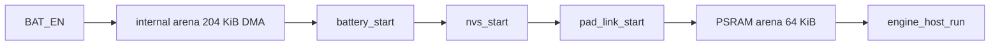

# Internal arena before BLE

NimBLE cannot be pointed at our allocator. Its controller, host pools, and host task stay on the IDF heap. Taking one internal block first leaves that heap as a single leftover, so BLE cannot split the bytes we own. The PSRAM arena is already a different heap.

The `Engine` object does not malloc a framebuffer. With the current flags, `DirtyGrid` does not allocate either. The bytes to move are the ones we already own: the DMA bands, the 8bpp buffer, the draw snapshot, four task stacks, and the `Engine` and `st7789_drawer` objects.

## Two stores

[`game/arena.c`](game/arena.c) keeps the bump allocator. [`game/`](game/) still does not include ESP-IDF or PixelRoot32. [`main/app_main.c`](main/app_main.c) allocates both blocks and passes the pointers in, the same way the PSRAM block works today.

Boot order in `app_main`:

The internal block is `heap_caps_malloc(ARENA_INTERNAL_BYTES, MALLOC_CAP_DMA | MALLOC_CAP_INTERNAL)`. A null result aborts. Bands are the first slice, so they sit on the DMA-capable pointer. Later slices align to 16 bytes, which FreeRTOS stacks require. The PSRAM carve stays 8-byte aligned and is unchanged: world 4096, level 32768, scratch 16384, spare 12288.

`ARENA_INTERNAL_BYTES` is 208896 (204 KiB). Named slices, then spare:

- bands 115200
- pixels 57600
- snapshot 8396
- sim stack 3072, present stack 4096, backlight stack 3072, pad stack 2048
- four task TCBs, 256 each (`static_assert` against `sizeof(StaticTask_t)`)
- engine 4096 (`static_assert` against `sizeof(Engine)`)
- drawer 256 (`static_assert` against `sizeof(st7789_drawer)`)
- spare is whatever the offset has not used

The early internal hole on the last measured boot was 271760 bytes. After this carve, about 60 KB remains as one heap region for NVS, the ADC, NimBLE, SPI, and `esp_lcd`. [`host/engine_host.cpp`](host/engine_host.cpp) `log_memory` prints both arenas' capacity and offset next to the free-heap line. If `pad_link_start` or the panel init fails, that line is the check, and the spare is what shrinks.

The PC target does not call the internal init. It keeps one `malloc` of the PSRAM size and the stack `Engine`.

## What moves into the internal slices

- [`host/st7789_drawer.cpp`](host/st7789_drawer.cpp) stops calling `heap_caps_malloc`. `init` uses the band and pixel slices. `st7789_alloc_bands` goes away, and so does its call in `app_main`.
- The draw snapshot (`view_slot` plus `draw_view`, 8396 bytes) leaves static BSS. The slot is placement-new'd so the seqlock atomic is constructed. Both tasks see it only after the carve.
- Sim, present, backlight, and the pad-reset task use `xTaskCreateStatic` / `xTaskCreateStaticPinnedToCore` with the stack and TCB slices. Sizes stay 3072, 4096, 3072, and 2048.
- The present task placement-news `st7789_drawer` and `Engine` into their slices. `operator delete` on the drawer is a no-op, so the `unique_ptr` inside `Renderer` cannot return those bytes to the heap. The present task does not destroy the `Engine`.

## What stays on the IDF heap

These allocate after the carve, from the leftover only:

- NimBLE controller, host pools, and the host task created by `nimble_port_freertos_init`
- NVS and the ADC unit
- SPI DMA descriptors, the `esp_lcd` panel, and the counting semaphore in `st7789_drawer::init`
- the dark `esp_timer`, and the pad-link semaphore created on the first light sleep
- FreeRTOS idle and timer stacks

## Record

Update the memory table, the boot paragraph, and the decision log in [`architecture.md`](architecture.md) in the same change. New residents: the internal arena and each slice above. The present-band and logical-buffer rows point at that arena. BLE stays "unmeasured, ESP-IDF".
