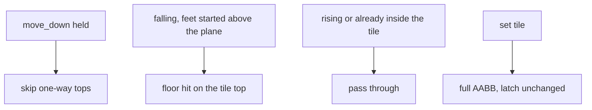

# One-way tile lip

Start here, and nowhere else. No wedges, no moving platforms, no tileset, no new sheet, and no growth of either arena. Engine physics stays off. The pit, the walls, the higher pockets, the right side, the spike, the checkpoint, and the exit stay set tiles.

## Kind

Add `MAP_ONEWAY` (`5`) in [`game/map.h`](game/map.h). In [`game/map.c`](game/map.c), change row 11, columns 0–3 from `MAP_SET` to that kind. Those four tiles are the lowest left pocket (world y 176). The other side platforms stay solid.

The collision is the top plane of the 16 px tile, the same face [`body_stop_y`](game/world.c) already uses for a set tile. The 4 px lip is only what present draws. A 4 px box would bonk from below, so the underside is not a volume.

## Tick

[`apron_set_box`](game/world.c) stays set-only, so x, the wall latch, the latch nudge, and [`body_embed`](game/world.c) never see a one-way. A new helper writes the top of a one-way slot in the 3×3.

In [`body_stop_y`](game/world.c), after the set faces, a falling move (`dest > y0`) stops on a one-way top when the feet started at or above it (`y0 + height <= top`) and the destination crosses it. That is a floor hit: `vy` zeros, the latch clears, and [`cam_note_ground`](game/world.c) takes the line. Rising does not test that face. Overlap from inside the tile does not push the body out, so a jump that peaks below the plane keeps falling.

[`body_solve_y`](game/world.c) takes the snapshot. While `move_down` is held, that tick skips one-way tops and still stops on set tiles. Releasing down does not pull the body back onto a plane it already passed. The jump edge is still consumed, the same way a down press already consumes a wall jump.

Standing on the lip is a normal floor: a jump edge fires, and the higher gravity applies while the jump is held.

## Present

[`world_solid_count`](game/world.c) and [`world_solid_rect`](game/world.c) emit a one-way as a rect at the tile origin, 16 px wide and 4 px tall. The view test uses that lip, not the full cell. The host already fills `solids[]` in black and marks dirty rows from the rect height, so [`host/engine_host.cpp`](host/engine_host.cpp) does not learn a new kind. The 256-slot cap still holds: these four replace set tiles.

## Record

In [`architecture.md`](architecture.md), say the one-way kind, the plane, the down drop, and the 4 px lip. The course sentence names that pocket. The line that still defers one-way platforms becomes wedges only. One decision-log row. Refresh the `[body_stop_y]`, `[body_solve_y]`, `[world_tick]`, `[world_solid_count]`, and `[world_solid_rect]` comments.