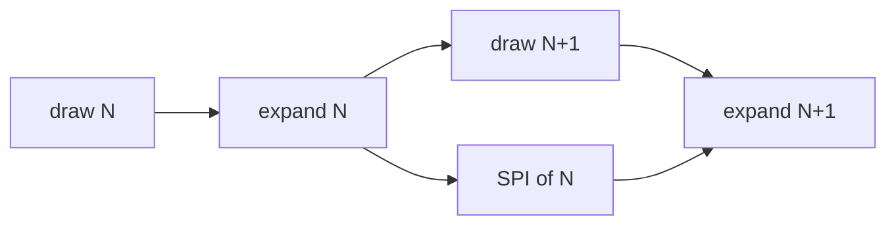

# Overlap the next draw with the SPI tail

The second at 21.9 s in the monitor is the full-glass case: 61 busy frames, 232 mean dirty rows, 16.0 ms per loop (about 62 Hz). Means on that second:

- draw (mask + ground + solids + body + debug) is 2.9 ms. Debug alone is 1.8 ms.
- expand is 3.7 ms.
- spi is 9.3 ms, and that number starts only after both expands have been queued.

SPI reads the RGB565 bands, not the 57600-byte index buffer. Once expand returns, core 1 is idle in `spi_wait` and the indices are free. The next draw fits in that 9.3 ms tail with about 6 ms to spare, debug included. Hiding it, and letting the next expand start as soon as one band frees, should pull a full rewrite from 16 ms down to the wire, about 12 ms (around 80 Hz).

A second index buffer still does not fit. This boot’s largest internal block after NimBLE is 31744 bytes. The spare in the arena is 9648. Leave the bands at 120 rows.

## Change

[`host/st7789_drawer.cpp`](host/st7789_drawer.cpp) `sendBuffer` keeps `pending` and `slot` local and drains both DMAs before returning. Persist both on the drawer (constructor starts them at 0). Delete the final `while (pending > 0)` drain. The existing `pending == 2` wait still blocks before a band is overwritten, so a DMA never shares its band with the next expand.

The next `Engine::run` draws into the same indices before it calls `sendBuffer` again. That draw is the overlap. An empty mask still returns without touching the bands or the in-flight count; the following dirty frame takes the semaphore when it needs a band.

Duty 0 is the one place that must still drain. The present loop in [`host/engine_host.cpp`](host/engine_host.cpp) parks on `!st7789_lit()` at the top of the next iteration, which is after `sendBuffer` has returned with DMA in flight. Add a drawer drain and call it there, before `ulTaskNotifyTake`, so the band on the wire finishes and no new one starts. Light sleep is 30 s later on core 0 and already sees a finished bus.

`spi` in the frame log moves. The wait to reuse a band is counted on the next loop, which is also the loop whose draw ran during that wait. Section names stay. A full-dirty second should show the core1 total near 12 ms per loop, with `n` near 80. Draw and expand microseconds stay about where they are; they stop stacking on top of the wire.

## Record

Update the display paragraph and the duty-0 sentence in [`architecture.md`](architecture.md): `sendBuffer` returns with the last band on the wire, the next present draws the same indices while that DMA finishes, and a band is filled again only after its semaphore. One decision-log line. Refresh the `[st7789_drawer::sendBuffer]` and `[present_task]` comments.

Debug stays. Its 1.8 ms fits in the tail, and it is off during play. No second buffer, no band resize, no core move.

## Prediction

Measure a second that looks like the 21.9 s sample: debug on, camera moving, `rows` mean near 230 and max 240. The logged means divide by every loop, including empty ones. On that sample `n` was 63 and `empty` was 2, so a busy frame was a little above the printed mean. Reconstructed busy frame, today:

- draw 3.0 ms (mask 32, ground 161, solids 461, body 496, debug 1838)
- expand 3.8 ms
- spi 9.6 ms
- engine 0.1 ms
- loop 16.5 ms, about 61 busy frames in the second

The 9.6 ms is the drain after both bands are queued. The wire for a full frame is 12.3 ms, so about 2.6 ms of the first band's SPI is hidden inside the second expand, and the first expand (about 1.2 ms) runs with the bus idle. That is why the second expand is the long half: it shares SRAM with DMA.

After the change, steady state for that same full frame:

- The next loop draws for 3.0 ms while the previous tail runs. The oldest band frees about 3.4 ms after `sendBuffer` returns, so the first reuse waits about 0.4 ms.
- The first expand of the new frame may grow. Today it does not fight DMA. After, it does. If it grows from 1.2 ms toward the contended 2.6 ms, `expand` rises and `spi` falls by the same amount. The loop does not.
- The new first band is queued about 3 to 5 ms before the previous frame's bus goes idle. The period becomes the wire.

Expect, on that second:

- `core1` total still about 1 s. `n` 75 to 85. Center 82. `empty` 0 to 5. `rows` mean still about 230, max 240.
- Loop 11.5 to 12.8 ms. Center 12.2 ms. Below 11.5 ms on a 240-row frame means a band was reused too early or rows were skipped.
- mask, ground, solids, body, debug each within about 15% of 30, 160, 450, 500, 1800 µs. Same draw code.
- `expand` + `spi` together 8.5 to 10.0 ms. Center 9.1. Today that sum is 13.4 on a busy frame.
- `expand` alone 3.7 to 5.5 ms. A rise toward 5 ms with `spi` near 4 ms is the contention case, and it is still a hit.
- `spi` alone 4.0 to 6.5 ms. Center about 5.3 if `expand` stays 3.8, about 4.1 if `expand` rises to 5.0. Today 9.6. Max on a full frame about 6.5, not the old 10 ms.
- `engine` 80 to 150 µs. `wait` under 50 µs if `empty` is near 0.
- The corner FPS, which counts presents, reads about 75 to 85. Today that second would have read about 60.
- Core 0 stays put: `n` near 1000, `wait` near 970 µs, `sim` near 20 µs. Sim keeps producing about 83 snapshots a second. Today present keeps about 61 of them. After, it keeps about 80, so the glass advances one 12 ms tick per frame instead of skipping ahead.

Standing still stays the idle log: `n` near 1000, `empty` near 1000, `wait` near 968 µs, `spi` 0. A small dirty region (about 20 rows, body and a platform) has a tail near 1 ms, so the overlap saves a fraction of a millisecond. Judge the change on the 230-row second, not on that one.

A miss looks like one of these:

- The 230-row loop is still about 16 ms. The drain is still inside the frame.
- `expand` + `spi` is still about 13 ms. Draw is not running during the tail.
- The loop is under 11 ms with `rows` max 240, or `n` is over 90. A band was reused while DMA owned it, or the mask skipped rows. The visible fault is a slab about 120 rows tall of stale pixels, stuck on the band split.
- A tear line that moves is not a miss. There is no TE pin, and a 12 ms rewrite still crosses the panel's own scan.