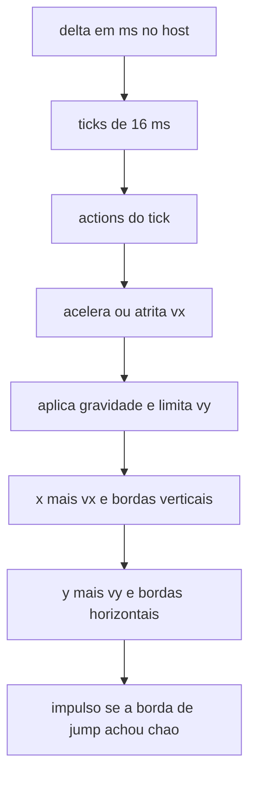

# Movimento na gaiola da tela

O retângulo de 16×16 deixa de andar 2 px por frame. Passa a ser um corpo cinemático, no espírito do [N Tutorial A](https://www.metanetsoftware.com/2016/n-tutorial-a-collision-detection-and-response): integra, move um eixo, responde, depois o outro. O school-n em `f:\Repos\refs\school-n--master` serve só de referência de mecânica. Não entram as classes, o `std::vector`, o `new` por overlap, o passo a 240 Hz, o movimento XY junto com SAT, nem as constantes de `Ninja.h`.

## O que este corte faz

- Esquerda e direita aceleram até um teto. Sem eixo horizontal, a mesma taxa trava até zero. Esquerda e direita juntas continuam se anulando, como hoje em [`game/world.c`](game/world.c).
- Gravidade para baixo (Y cresce para baixo, igual ao desenho). Com o pulo segurado e subindo, a gravidade é a menor. Soltar, ou já estar caindo, usa o dobro.
- Pulo só na borda de subida de `jump` (A / K) e só se o tick anterior terminou no chão. Segurar A não faz o corpo pular de novo ao aterrissar.
- As quatro bordas da view param o corpo e zeram a velocidade daquele eixo. Sem quique. Sem wall slide e sem wall jump: a parede só zera `vx`.
- Sem link, ou sem tecla no PC, o snapshot continua limpo, mas o corpo não volta ao centro. Cai e descansa na borda de baixo.
- D-pad para cima e para baixo não movem o corpo.
- O canto superior direito mostra quantos frames foram apresentados, nos dois alvos.
- No device, um toque em BOOT derruba o link do Pad Emu e o central volta a escanear. PLUS continua sem leitura.

O chão não é um tile desenhado. O fundo continua a cor do link. O corpo simplesmente para na borda inferior.

## O sim não segue o frame

Hoje [`world_tick`](game/world.c) anda 2 px cada vez que [`rect_scene::update`](host/engine_host.cpp) roda, e o `delta_time` é ignorado. Esse update não é um frame fixo. Em [`Engine::update`](third_party/pixelroot32/src/core/Engine.cpp) o delta é `millis()` menos o millis anterior, em milissegundos inteiros. No PC o laço apresenta e depois faz `SDL_Delay(1)`, então o delta costuma ser 1 ms e às vezes 0. No device, [`millis`](compat/Arduino.h) é `esp_timer_get_time() / 1000`, e cada `Engine::run` é um present, cerca de 12 ms só no fio mais o desenho.

`world_tick` não recebe tempo e não multiplica velocidade por delta. Um tick é sempre o mesmo deslocamento. O host é quem decide quantos ticks cabem no tempo de parede:

- Soma o `delta_time` num acumulador.
- Enquanto o acumulador tiver 16 ms, e ainda não tiver feito 4 ticks neste update, chama `actions_capture` e `world_tick` e tira 16 ms.
- Delta 0 soma nada. Não vira um tick. Dois updates no mesmo milissegundo não andam o corpo duas vezes.
- Se os 4 ticks não esgotam o acumulador, o resto é zerado. Abaixo de 16 ms o resto fica, para um frame de 17 ms não perder 1 ms.
- 4 ticks cobrem 64 ms. Um present mais lento que isso atrasa o corpo de propósito, em vez de espiralar.

16 ms é o passo que esse relógio consegue marcar (62,5 Hz). Não é 1000/60. A distância por segundo de parede é a mesma a 30, 60 ou 200 presents, enquanto o frame couber em 64 ms. O número no canto é a taxa de present, não a taxa do sim.

## Passo e números

As constantes são subpixels por tick (`1 px = 256`), em `int`, na slice que [`world_init`](game/world.c) já usa. A slice de 4096 bytes não muda de tamanho.

- Aceleração e atrito horizontal: 64 subpx/tick² (0,25 px). Teto: 768 (3 px/tick, ~188 px/s). Do zero ao teto, ou do teto à parada, são 12 ticks (~0,2 s).
- Impulso do pulo: −2048 (−8 px/tick). Gravidade segurando e subindo: 128. No resto: 256.
- Altura com o botão segurado: ~64 px, ápice em ~16 ticks. Toque curto cai na gravidade dobrada e fica perto da metade disso.
- Teto de queda: 2048 (8 px/tick), menor que o corpo de 16 px. Isso é o limite anti-túnel deste corte. Varrer o movimento fica para quando existirem tiles; contra a borda da tela, o clamp já é exato.

São números nossos, para uma gaiola de 240 px. Não são os de `MOVE_SPEED` / `GRAVITY` / `JUMP_FORCE` do school-n. Ajustar o feel é mudar essas constantes.

## Ordem de um tick

O chão deste tick libera o pulo no fim, então aterrissar e apertar no mesmo tick sobe no tick seguinte. Não há coyote time nem jump buffer.

A linha 0 da SoA guarda `x`, `y` em subpixel, `vx`, `vy`, e o contato da borda (esquerda, direita, chão, teto) mais o `jump` do tick anterior. [`world_rect`](game/world.h) continua entregando pixels inteiros para o desenho, pelo deslocamento de 8 bits. O spawn segue no centro e cai.

## BOOT religa o Pad Emu

Fechar o emulador Android e abrir de novo não devolve o link. O central tem uma conexão só. [`watch_cb`](main/pad_link.c) deixa `PHASE_LINKED` quieta, e o supervision de 2 s só age se o controller entregar a queda. Quando o emulador some sem `BLE_GAP_EVENT_DISCONNECT`, o slot continua ocupado e o anúncio novo nunca vira conexão. O fundo fica verde com um mailbox parado.

BOOT é GPIO0, hoje reservado e sem leitura. Depois do boot do app, [`pad_link_start`](main/pad_link.c) configura o pino como entrada com pull-up. A leitura não entra no drawer: PWR continua só no backlight. Uma task de 2048 bytes, na SRAM interna, amostra o pino a cada 20 ms, no mesmo debounce do PWR: ignora até ver o pino solto, e aceita o toque depois de duas amostras pressionadas. Segurar não repete. O nível pressionado é 0.

A task só arma um callout na event queue do NimBLE. O reset em si roda nessa fila, que é onde `ble_gap_*` pode ser chamado:

- Zera botões e hat, e marca o link como caído.
- Cancela scan ou connect em curso.
- Se há conexão, `ble_gap_terminate`. O `DISCONNECT` que já existe chama [`start_scan`](main/pad_link.c). Se o terminate falhar, o próprio reset chama `start_scan`.
- Uma conexão que completa depois do toque também é terminada, para o slot único ficar livre para o emulador novo.

O log escreve `boot reset`. O fundo volta ao âmbar enquanto escaneia e ao verde quando o notify sobe de novo. O PC não tem esse botão.

A task entra na tabela de memória de [`architecture.md`](architecture.md): stack do reset do pad, interna, 2048, dono `pad_link`. PLUS segue sem leitura.

## FPS no canto superior direito

O contador deixa de ser só do PC e deixa o canto superior esquerdo. Os dois alvos usam o mesmo desenho.

A fonte padrão do engine, ligada em `Engine::init`, é `FONT_5X7`: glifo de 5×7 e 1 px de espaço. [`drawText`](third_party/pixelroot32/src/graphics/Renderer.cpp) trata o último argumento como multiplicador, e 1 é o menor que ainda desenha. Não há fonte menor no engine, e o tamanho 0 some.

O host conta os presents numa janela de 500 ms, com o mesmo `delta_time` do update, inclusive 0 e os maiores que 100. O rótulo é `"%d FPS"`, em branco, tamanho 1. A posição X é `240 - textWidth - 1`, Y é 0, medida por `FontManager::textWidth` para o texto daquele frame. Um `"999 FPS"` ocupa 7 células de 6 px e continua dentro da tela.

## Arquivos

- [`game/world.c`](game/world.c) e [`game/world.h`](game/world.h): o solver no lugar de `WORLD_STEP` e `clamp_pos`. Sem parâmetro de tempo. Comentários `[id]` em pt-BR, inclusive os que deixarem de valer.
- [`host/engine_host.cpp`](host/engine_host.cpp): o acumulador de 16 ms, e o FPS no canto superior direito nos dois alvos. O retângulo branco não muda.
- [`main/pad_link.c`](main/pad_link.c) e [`main/pad_link.h`](main/pad_link.h): a task do GPIO0 e o callout que termina o link e escaneia de novo.
- [`architecture.md`](architecture.md): a seção Physics descreve o tick de 16 ms e que a velocidade não escala com o present; o gamepad deixa de dizer que A sobe o retângulo enquanto segurado e que, sem input, ele volta ao centro; o parágrafo do PC passa a dizer que os dois alvos desenham o present rate no canto superior direito, na 5×7 em tamanho 1; BOOT passa a resetar o link, PLUS continua sem leitura, e a tabela de memória ganha a stack de 2048. Uma linha no decision log fecha o timestep e registra estas constantes como o primeiro tune. Outra linha registra o reset pelo BOOT. `PIXELROOT32_ENABLE_PHYSICS` continua 0. A slice `level` continua vazia.
- [`README.md`](README.md) e a linha correspondente em [`open_questions.md`](open_questions.md): o mesmo comportamento, no lugar de “steps / stays centered”, e o FPS nos dois alvos.

## Como provar

`pc.bat`. O corpo nasce no centro, cai e para embaixo no mesmo tempo de parede ainda que o número do canto mude. A e D aceleram e param ao soltar. K (ou A do pad) pula; soltar cedo encurta a subida; segurar não repete o pulo no chão. Encostar na esquerda, na direita ou no teto zera aquele eixo. W e S não voam. Sem tecla e sem pad, o corpo fica no chão, não no centro. O texto fica no canto superior direito, 7 px de altura. No device o mesmo texto aparece sobre o fundo do link. Fechar o emulador, abrir de novo e tocar BOOT: o fundo sai do verde, passa pelo âmbar e volta ao verde quando o Pad Emu notifica. Segurar BOOT não fica religando.
