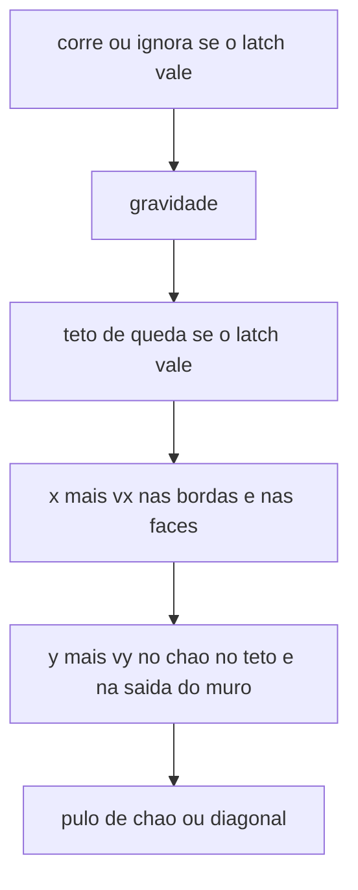

# AABBs estáticos dentro da gaiola

O tick de 16 ms em [`game/world.c`](game/world.c) não muda de ordem. As quatro bordas da View continuam sólidas. Cada plataforma é um AABB de quatro faces: o topo é chão (pulo vertical, solta o latch), os lados gravam o latch (slide, pulo diagonal, down solta), a base é teto (zera `vy`, o latch fica). Sem one-way, sem tile, sem plataforma que se move. `PIXELROOT32_ENABLE_PHYSICS` continua 0.

## Onde moram

A slice `world` fica 4096, `WORLD_COLS` 12. Os sólidos entram na slice `level`, hoje vazia, em SoA de quatro colunas `int` em pixels: `x`, `y`, `w`, `h`, origem no canto superior esquerdo da View.

`SOLID_CAP` 32. 32 × 4 × 4 = 512 bytes dos 32768. A tabela de memória não muda de tamanho; a nota da slice `level` passa a citar essa SoA. Passar do cap faz [`world_init`](game/world.c) falhar, em vez de cortar a lista.

A lista de prova é `static const` no próprio [`game/world.c`](game/world.c) e é copiada para a slice em [`world_init`](game/world.c). Sem formato de level e sem arquivo novo. O corpo continua subpixel (`<< 8`); o sweep promove o retângulo na hora.

A coluna do spawn, pixels x 112–128, fica vazia. Sem tecla, o corpo ainda cai e descansa na borda de baixo.

- Degrau esquerdo `(16, 184, 64, 16)`. O topo está 48 px acima do chão; o pulo segurado sobe cerca de 60 px.
- Teto sobre esse degrau `(16, 96, 64, 16)`. No degrau, o pulo segurado encosta na base.
- Degrau direito `(136, 176, 32, 16)`. Fora da coluna do spawn, alcançável do chão.
- Pilar `(176, 64, 24, 128)`. A face esquerda é muro no ar. A base fica em y 192, então dá para passar por baixo no chão e encostar nela no pulo.

Nenhum par se sobrepõe. Se dois sólidos se cruzarem no futuro, vale a primeira face no caminho.

## Sweep

[`body_solve_x`](game/world.c) e [`body_solve_y`](game/world.c) passam a tratar a borda da View e as faces no mesmo teste. Encostar na aresta não conta: em pé no topo, o lado não agarra.

- No x, com o y ainda o do tick: entre as faces verticais que o movimento cruza e com as quais o y se sobrepõe, para na mais próxima. `vx` zera. Direita do corpo na face esquerda do sólido grava latch `1`; o inverso grava `-1`. `move_down` continua impedindo o grude, como na borda.
- No y, com o x já resolvido: caindo, a face de cima mais próxima é chão, zera `vy` e solta o latch. Subindo, a face de baixo mais próxima é teto e zera `vy`. A borda de baixo e a de cima da View seguem nesse mesmo par.
- O latch só permanece se, depois do y, aquele lado ainda estiver rente à borda da View ou a uma face com sobreposição no outro eixo. Esgotar a altura do pilar solta no mesmo tick, antes do pulo. Soltar o down não regruda até o `vx` cruzar uma face de novo.
- A queda máxima é 8 px e o pulo de parede anda cerca de 6 px. O teste é a face cruzada neste tick, então um retângulo mais fino que isso não é atravessado. Corpo que comece o tick dentro de um sólido é empurrado para fora no eixo que está movendo. O graybox não faz isso.

[`body_run`](game/world.c), [`body_slide`](game/world.c) e [`body_jump`](game/world.c) ficam. O canto em que o chão e o muro caem no mesmo tick continua sendo pulo de chão, porque o y solta o latch antes do impulso.

## Desenho

[`game/world.h`](game/world.h) ganha a contagem e o retângulo em pixels. Índice fora da contagem zera a saída.

[`host/engine_host.cpp`](host/engine_host.cpp) pinta o ground, depois cada sólido com `Color::Black`, depois o corpo branco, depois o FPS. Preto lê no verde do PC e no vermelho, âmbar e verde do link. A tela fica em três cores: ground, preto, branco. O graybox não entra no canto do FPS.

## Docs

- [`architecture.md`](architecture.md): a seção Physics descreve os AABBs, o cap 32, o sweep e que o latch vale para as faces. Tiles, cunhas, one-way e hazards continuam para depois. Uma linha no decision log. A nota da slice `level` deixa de dizer que está vazia.
- [`README.md`](README.md): nos dois alvos, os retângulos pretos; pousar e correr em cima; muro no pilar com S ou baixo soltando; base como teto; bordas da tela iguais; sem tecla, o corpo ainda descansa embaixo.
- [`open_questions.md`](open_questions.md): uma linha na tabela de decisões.

Comentários `[id]` em pt-BR nas funções novas e nas que mudarem de efeito, inclusive [`body_solve_x`](game/world.c), [`body_solve_y`](game/world.c) e [`world_init`](game/world.c).

## Como provar

`pc.bat`. Sem tecla, o corpo cai na borda de baixo, entre os degraus. K alcança o degrau esquerdo e o direito; em cima deles, K é pulo de chão. No degrau esquerdo, K segurado encosta no teto preto e a subida corta. Correr no ar contra o pilar gruda: A e D não empurram, a queda fica lenta, S solta, K na subida sai na diagonal. As bordas da tela continuam com o mesmo latch. W não move.
