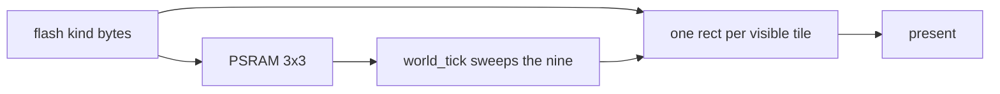

# Tile apron strip

Start here, and nowhere else. No tileset art, no extra character sheets, no SRAM staging, and no growth of the 64 KB PSRAM arena. The body sheet and the palette stay in flash. Present still draws rects from the snapshot and never reads the apron.

There is no solid in this slice, and no merged floor rect. Terrain is tiles that are set.

## How a tile is stored

A tile is not a sprite and not an AABB record. It is one byte in a `const` table in flash. The byte is the kind:

- `0` empty
- `1` set
- `2` spike
- `3` checkpoint
- `4` exit

A set tile blocks. Empty does not. Spike, checkpoint, and exit do not block.

The table is indexed by tile column and tile row. A tile is 16×16 px, so tile `(tx, ty)` covers world pixels `[tx * 16, tx * 16 + 16)` by `[ty * 16, ty * 16 + 16)`. The strip is 8 view-cells. Each cell is the 240 px view, so it is 15 tiles wide and 16 tiles tall (the last row is y 240–256, under the glass). A read past either edge of the strip is empty. Wedges and one-way tiles stay out.

Every cell is filled in that grid. A floor cell has all 15 tiles of its bottom visible row set (y 224–240). A pit cell leaves that row empty. The old 32 px ground rect is not recreated. Walls and platforms are set tiles in the same grid, still with the cage gaps: wall faces 48 px apart, platforms one tile thick, a held jump of about 4 tiles reaching the next step. It is a new course in the same language, not a pixel copy of `solid_course`.

[`game/`](game/) does not include ESP-IDF. Both targets use the same table. The bytes stay in flash. The sim does not copy the strip.

## The apron

The occupied tile is the one that contains the body center. The apron is that tile plus the eight around it: a 3×3 of kind-bytes in the existing level slice of [`game/arena.c`](game/arena.c), plus the column and row of the center. Nine bytes. The old six-column solid SoA goes away. The 32 KB level slice stays; most of it becomes spare.

[`world_init`](game/world.c) loads the 3×3 around the spawn tile. At the start of [`world_tick`](game/world.c), before the move, a new occupied tile reloads the nine bytes from the flash table. The same reload recenters on the checkpoint at respawn, and on spawn in [`world_reset`](game/world.c). Death does not reload. A reload is a copy into the fixed nine bytes. There is no `arena_free`.

One tile of margin is enough for this tick. The body is 8×12, and the fall cap was chosen so one tick does not cross a 16 px tile. Vertical paging is the same reload as horizontal paging.

## How a tile collides

The body stays an 8×12 AABB. The axis sweep, the strict edge test, and the wall latch stay. The candidates are the set bytes inside the 3×3. Each of those is tested as a 16×16 rect at `tx * 16, ty * 16`. The tick does not walk the strip, and it does not expand the nine bytes into the 256-rect snapshot list.

Empty does nothing. Spike, checkpoint, and exit are tested after the vertical move, as the single rects are today. The first strip has one of each, so a view never holds two.

A wall of stacked set tiles keeps the slide. The latch is a one-subpixel nudge that accepts any set face, and a floor hit requires the body to overlap that tile in x. Flush tiles share one face, so the seam is not a floor. A step in the face is a ledge, and the latch drops there as it does today. Standing on a floor cell is standing on those bottom-row tiles, not on a separate floor object.

## What present sees

The 3×3 is the sim. The camera view is wider than that, so [`host/engine_host.cpp`](host/engine_host.cpp) cannot learn the floor from the apron. `world_solid_count` and `world_solid_rect` scan the flash strip and emit one 16×16 rect per set tile that crosses the view. Spike, checkpoint, and exit stay their own rects. Nothing is merged. One view is at most 240 tiles, under the snapshot cap of 256. Present still does not read the level slice.

## Record

Update the memory table, the course paragraph, and the decision log in [`architecture.md`](architecture.md) in the same change. Square tiles are no longer "later." The level slice's resident is the nine kind-bytes. BLE and the internal arena stay as they are.
