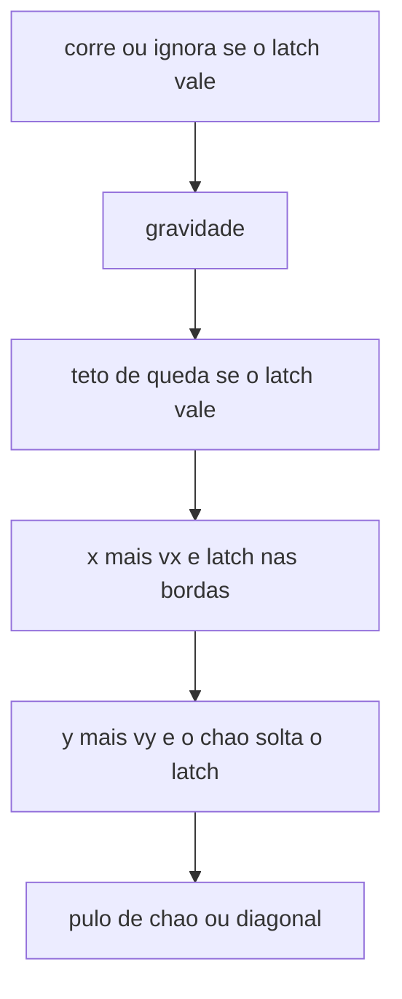

# Wall slide e wall jump na gaiola

O corpo continua o tick de 16 ms em [`game/world.c`](game/world.c). As bordas continuam sólidas e sem quique. O que muda é o latch de parede, no espírito do `wallNormal` de `Ninja.cpp` no school-n: encostar gruda, esquerda e direita não empurram, soltar a parede é o down, e o pulo na parede usa a mesma força do chão partida na diagonal. Não entram classes, `new`, dt variável, nem as constantes de `Ninja.h`.

A slice de 4096 não cresce. `WORLD_COLS` passa de 11 para 12. A coluna nova, na linha 0, é o latch: `-1` esquerda, `1` direita, `0` nenhum. O host, o FPS, o BOOT e o snapshot não mudam.

## Latch

O clamp de [`body_solve_x`](game/world.c) já só dispara quando a posição cruzaria a borda. Com `vx` 0 e o corpo rente, o tick seguinte não marca contato. O latch guarda o grude entre esses ticks.

- O clamp na esquerda ou na direita, sem `move_down`, grava o latch daquele lado e zera `vx`.
- O chão, em [`body_solve_y`](game/world.c), zera o latch. No canto de baixo vale o pulo de chão.
- O teto continua zerando `vy` e não solta o latch.
- Sair da borda (o `x` deixou de estar nela) zera o latch.
- `move_down` segurado zera o latch e impede um clamp no mesmo tick de gravar de novo. No Pad Emu, a diagonal baixo-esquerda acende os dois, então ela cai rápido em vez de regrudar.

Enquanto o latch vale, [`body_run`](game/world.c) não mexe em `vx`. Soltar o down não regruda: o corpo pode ficar rente, caindo em velocidade cheia, até um tick em que o `vx` cruze a borda outra vez. Segurar para dentro da parede depois de soltar o down faz isso no tick seguinte.

## Slide

Sugestão de primeiro tune, porque o equilíbrio do school-n (~96 subpx/tick, uns 10 s para descer os 224 px úteis) deixa a gaiola parada demais. `WORLD_SLIDE_MAX` 256: 1 px/tick, ~3,6 s para descer a tela, contra o teto de queda de 2048.

Depois da gravidade, se o latch vale e `vy` passa de 256, `vy` vira 256. Subindo, a gravidade não muda. O tick em que o clamp gruda ainda cai na velocidade daquele tick; o teto entra no seguinte.

## Pulo na parede

Mesma borda de subida de `jump` que o chão. Sem coyote e sem buffer: segurar A ao encostar não dispara. `move_down` nesse tick também não dispara, e a borda de `jump` é consumida do mesmo jeito de hoje.

Impulso: `WORLD_WALL_JUMP` 1448, o inteiro de `2048 / sqrt(2)`. Parede esquerda: `vx = 1448`, `vy = -1448`. Parede direita: `vx` negativo. O latch zera. A gravidade que já existe encurta a subida se soltar o botão: cerca de 32 px segurando, cerca de 16 px no toque curto. O pulo de chão segue −2048.

O teto de corrida não pode engolir esse `vx`. Hoje [`body_run`](game/world.c) corta qualquer `|vx|` acima de 768 no tick seguinte, e o 1448 viraria 3 px antes de aparecer. Enquanto `|vx|` passa de 768, o eixo ignora esquerda e direita e perde 64 por tick até o teto. Só o pulo de parede produz essa velocidade. Corrida normal, de 0 até 768, fica igual.

Segurar para dentro da parede depois do pulo não puxa de volta durante esses ~11 ticks. Não há coluna de timer.

## Arquivos

- [`game/world.c`](game/world.c): constantes, coluna `row_wall`, o teto de slide, o impulso diagonal, e o sangramento acima do teto de corrida. Comentários `[id]` em pt-BR, inclusive os de [`body_run`](game/world.c), [`body_solve_x`](game/world.c), [`body_solve_y`](game/world.c) e [`body_jump`](game/world.c).
- [`architecture.md`](architecture.md): a seção Physics deixa de dizer que não há wall slide nem wall jump. O latch, o teto 256, o impulso 1448 e o sangramento acima de 768 entram no tune. `move_down` solta a parede e não move o corpo no ar livre. W continua sem efeito. Tiles, cunhas e hazards seguem para depois. Uma linha no decision log. `PIXELROOT32_ENABLE_PHYSICS` continua 0. A tabela de memória só ganha o latch na frase da slice `world`; o tamanho 4096 fica.
- [`README.md`](README.md): nos dois alvos, encostar na esquerda ou na direita gruda e desce devagar; S ou baixo solta; K ou A na borda de subida sai na diagonal; o chão continua o pulo vertical.
- [`open_questions.md`](open_questions.md): uma linha na tabela de decisões, com o tune da parede, revisitando quando o feel da gaiola mudar.

## Como provar

`pc.bat`. Correr contra a esquerda ou a direita gruda: A e D não empurram, e a queda fica lenta até o chão. S, com ou sem a direção da parede, cai na velocidade cheia; soltar S rente à parede não regruda até cruzar a borda de novo. K na subida da tecla, grudado e fora do chão, sai na diagonal e o arco encurta se soltar cedo. Segurar K no ar e encostar não pula sozinho. No canto de baixo, K faz o pulo de chão. W não move. Sem tecla, o corpo descansa embaixo. O número do canto não muda o tempo de parede.
